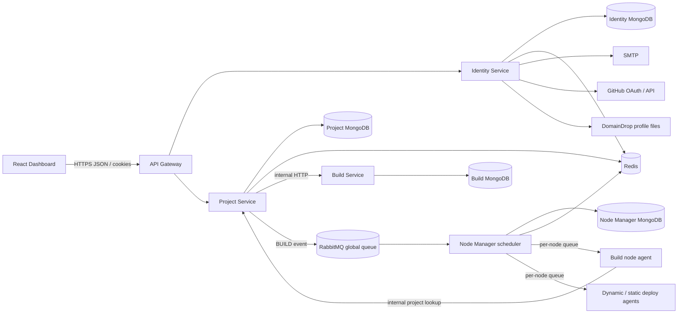
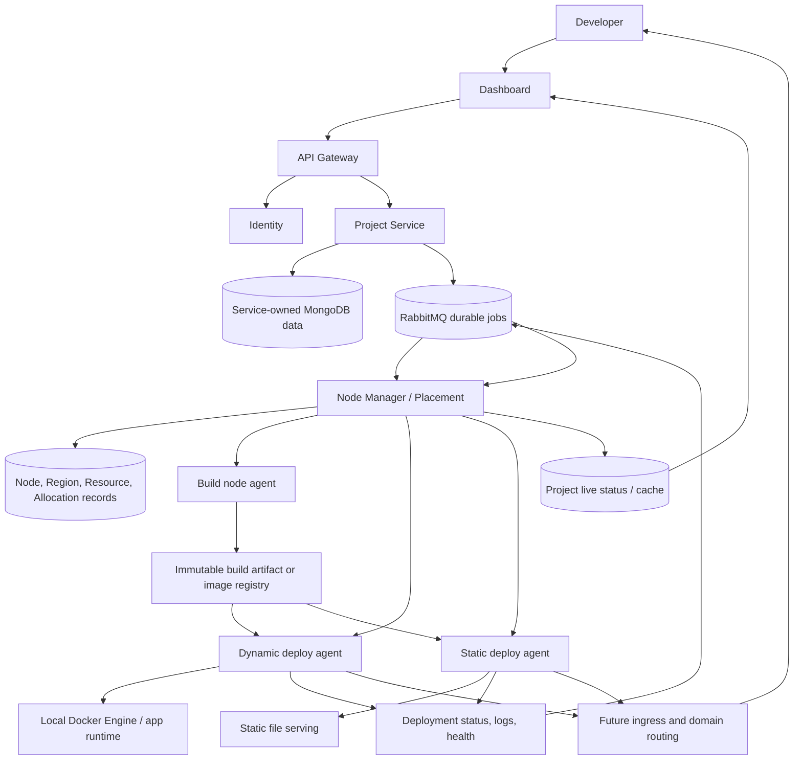

# DeployHub: Product, Stack, and System Design

> **Status:** Code-grounded design and forward roadmap  
> **Last reviewed:** 2026-11-05  
> **Scope:** Current repository structure, implemented foundations, known in-progress areas, and the intended deployment platform.

This document separates what exists in the repository from what DeployHub is intended to become. A component marked **planned** or **in progress** must not be treated as a production capability just because its model, queue, package, or route exists.

## 1. What DeployHub is

DeployHub is a self-service application hosting platform. A user creates a project from a GitHub repository, chooses a runtime or static-site build, and asks DeployHub to build and publish it. DeployHub owns account security, project configuration, payment and plan checks, build and deployment coordination, node selection, and status shown in the dashboard.

The platform is designed around two planes:

- **Control plane:** the dashboard, API Gateway, Identity, Project, Build, Node Manager, and supporting services. It stores intent and decides what should happen.
- **Execution plane:** build, dynamic-deploy, and static-deploy nodes. Each node runs a node agent that should perform only the work assigned to that node and report its result.

The user-facing product direction is similar to a managed deployment platform: connect a repository, configure its build and runtime, deploy it, watch status and logs, then manage the project and account from one dashboard.

## 2. Technology stack

| Area | Current repository stack |
|---|---|
| Language and modules | JavaScript, Node.js, ECMAScript modules. Most backend services use Express 5; the dynamic and static deploy agents use Fastify 5. |
| Dashboard | React 19, Vite 7, React Router 7, Axios, Recharts, Lucide React, React Hot Toast, Tailwind CSS 4 dependency/plugin, and repository CSS for themes and page styling. |
| API Gateway | Express 5, `http-proxy-middleware`, CORS, Helmet, compression, JWT verification, Redis-backed rate limiting, and trace IDs. |
| HTTP services | Express 5, `express-validator`, Axios for internal HTTP calls, and service-specific routers/controllers. |
| Database | MongoDB with Mongoose 9. Identity, Project, Build, and Node Manager have Mongo connection configuration. They use service-owned models; do not assume all services share one database. |
| Cache and short-lived state | Redis through ioredis. Used for sessions and refresh-token state, registration/OAuth state, rate limits, node locks, and project status updates. |
| Asynchronous work | RabbitMQ through `amqplib`, with a global build/deploy queue and per-node build/deploy queues. BullMQ is present in some package manifests, but the main visible build/deploy path uses RabbitMQ. |
| Container integration | Dockerode is present in the project/build agent dependency sets. The intended execution model is for node agents to operate the local Docker Engine; the full isolated build and runtime operation is still in progress. |
| Email and OAuth | Nodemailer over configured SMTP for verification/security email; GitHub OAuth and GitHub REST API for repository access. |
| Payment and file storage | Razorpay for paid plans; DomainDrop SDK for profile image storage. |
| Node metrics | `systeminformation` in node agents for CPU, memory, and disk observations. |
| Secret/config delivery | A Secrets Manager service maps approved service names to environment bundles. Some service registrations and agent delivery wiring remain incomplete. |

Package manifests define allowed version ranges, not a single pinned platform version. The dashboard declares Node `^22.12.0 || >=24.0.0`; backend packages declare Node `>=20.18.0` or do not declare an engine. For development, use a Node version compatible with the dashboard and all service manifests.

## 3. Repository map

```text
apps/
  api-gateway/                 Public API boundary and reverse proxy
  web/dashboard/               React user dashboard
services/
  identity-service/            Registration, login, GitHub OAuth, sessions, profile, 2FA
  project-service/             Project CRUD, plan/payment checks, build request publication
  build-service/               Build record creation and internal build API foundation
  node-manager/                Regions, node registry, health/resources, scheduling/allocation
  secrets-manager/             Service environment bundle registry and delivery API
agent/
  build-node-agent/             Build-node process and queue consumer foundation
  deploy-dynaic-node-agent/     Dynamic deployment agent foundation (directory name is misspelled)
  deploy-static-node-agent/     Static deployment agent foundation
shared/                         Queue names, cache keys, auth middleware, errors, utilities
docs/                            Project-specific architecture and roadmap
```

The root `readme.md` contains a broader intended architecture guide. This document supplements it with the technologies, paths, and maturity visible in this repository.

## 4. Current service responsibilities and maturity

| Component | Responsibility in the design | What the repository currently shows |
|---|---|---|
| Dashboard | Sign-up/sign-in, project management, plan selection, project status, account security and profile settings. | React routes exist for login, signup, workspace, project creation, billing/analytics, sessions, sign-in security, and profile. The API client calls the Gateway. |
| API Gateway | Public ingress, request validation/policies, auth check for protected project routes, rate limiting, health checks, traces, and proxying. | Routes are mounted for `/api/v1/auth/*` and `/api/v1/project/*`. Gateway verifies JWTs for protected project requests and forwards trusted user context. Node Manager and Build are not mounted in this public router. |
| Identity Service | Local registration and email verification, GitHub OAuth, login/refresh/logout, active sessions, user profile, and local-account 2FA. | Mongoose User model, Redis-backed session/OTP/OAuth state, SMTP email, encrypted GitHub token storage, and email/TOTP 2FA endpoints are present. |
| Project Service | Project configuration and ownership, free/paid plan enforcement, Razorpay order/payment verification, project lookup, and build-request publication. | Project model and service routes exist. Project creation calls Build Service to create a build record, publishes a global RabbitMQ event, and writes project status to Redis. An internal route exposes a project record to trusted callers. |
| Build Service | Build job record/API boundary and future build coordination. | Internal build creation route and MongoDB Build model exist. The implementation creates a `pending` build record; it does not yet provide a complete source checkout, build, artifact, and result pipeline. |
| Node Manager | Region/node registration, node credentials, health/resource snapshots, node suggestion, resource reservation, and build/deploy scheduling. | Models exist for `build`, `deploy-dynamic`, and `deploy-static` nodes. Dynamic nodes publish resource snapshots. Suggestion and allocation lifecycle code exists, along with a global queue worker. End-to-end callback and retry behavior still needs integration hardening. |
| Build Node Agent | Consume a build assignment, obtain project configuration, build in an isolated environment, publish an artifact, and report a result. | Agent starts a service, verifies the node, connects to Redis/RabbitMQ, consumes its build queue, and requests project data. Actual repository checkout/build/artifact/result reporting is not complete in the visible worker. |
| Dynamic Deploy Agent | Consume a dynamic-runtime assignment, run/replace the app, check readiness, report status and runtime resources. | Fastify health route, node verification, resource collection, Redis/RabbitMQ connection foundations exist. Full deploy command handling and status callback are not yet wired end to end. |
| Static Deploy Agent | Publish static build output and serve it from a static node. | Fastify health route, node verification, resource collection, Redis/RabbitMQ foundations exist. Static artifact transfer, serving, and release activation are still planned. |
| Secrets Manager | Return centrally configured environment bundles to approved services. | A registry maps several service names, with a secrets endpoint and logging. `getRegisteredServices()` currently advertises fewer services than the registry contains; node agents and Node Manager still need a consistent enrollment/config path. |

Monitoring, analytics, admin, domain/routing, and deployment service URLs appear in configuration, but they are not all present as complete services or Gateway routes in this repository. Treat them as future integration points.

## 5. System context

### Current code shape



This diagram shows repository-level connections, not proof that every runtime path is complete. Agent-side deployment execution and status return are still in progress.

### Intended target



The target flow adds durable artifact handoff, deployment results, health/readiness checks, and routing activation. The artifact store and routing layer are design targets; the repository does not yet implement them as a complete path.

## 6. Data ownership

Each service should own its records and expose them through its API or events. Avoid having one service write another service's Mongo collections directly.

| Data | Owner | Current record/store |
|---|---|---|
| User, credential hash, provider, GitHub identity, profile, 2FA | Identity Service | MongoDB `User`; sensitive temporary state and sessions in Redis. |
| Project configuration, project status, plan/payment references | Project Service | MongoDB `Project`, `PendingOrder`, and `CompletedOrder`; some live status updates in Redis Streams/PubSub. |
| Build request record | Build Service | MongoDB `Build`, currently a small record with user/project/name/status. |
| Node and region inventory | Node Manager | MongoDB `Node`, `Region`, `NodeCredential`, and `NodeResourceSnapshot`. |
| Placement reservation | Node Manager | MongoDB `NodeAllocation`; Redis node lock serializes concurrent selection. |
| User profile image binary | Identity Service integration | DomainDrop; MongoDB stores URL/file reference. |
| Build artifacts and deployed releases | Future owner/contract to define | No complete artifact/release record or registry flow is visible yet. |

`Project` and `Build` are not the same entity. A project is desired configuration; a build is one attempt to create deployable output. The next durable model to introduce is a separate **Deployment/Release** record that captures the build/artifact, selected node, status transitions, timestamps, and active version.

## 7. Important technology and communication choices

### Synchronous HTTP

- Browser calls the Gateway under `/api/v1`.
- Gateway proxies `/v1/auth` to Identity and `/v1/project` to Project Service.
- Project Service calls Build Service for internal build-record creation.
- Build Node Agent calls Project Service's protected internal project lookup.
- Internal requests use configured internal secrets; they should stay on a private service network.

### RabbitMQ

Queue names are centralized in `shared/queues/queueNames.js`:

| Queue | Intended use |
|---|---|
| `deployhub-global-build-deploy` | Project Service publishes work/status; Node Manager coordinates scheduling. |
| `deployhub-global-build-deploy-retry` | Retry/waiting queue exists in the contract; scheduler retry behavior must be made reliable before depending on it. |
| `deployhub-build-<nodeId>` | Work addressed to one build node. |
| `deployhub-deploy-<nodeId>` | Work addressed to one deploy node, dynamic or static. |
| `deployhub-build-status-updates`, `deployhub-deploy-status-updates` | Named status queues exist; full producer/consumer use is not yet consistently wired. |

Events use `event`, `status`, project/build identifiers, project type, and later the node/allocation identifiers. Current status constants include queued/completed/cancelled/failed/released values for build and deploy. A production event contract should add a schema version, event/job ID, idempotency key, attempt count, and timestamp.

### Redis

Redis is not the durable project/build database. Current uses include authentication sessions and short-lived tokens, registration OTP and OAuth state, Gateway rate limiting, node-selection locks, and project status streams/pubsub. Persisted deployment history must live in a database; Redis status should be a live view/cache.

### Node type and allocation model

The intended node types are:

| Type | Intended role | Reservation behavior |
|---|---|---|
| `build` | Temporary source build/package work. | Pending slot while work runs; delete reservation on success, failure, cancellation, or release. |
| `deploy-dynamic` | Backend services such as Node, Go, Python, and Java apps. | Reserve requested CPU/memory/disk for up to 30 minutes while pending. On success, convert to a non-expiring confirmed allocation. On failure or explicit release, delete it. |
| `deploy-static` | Static sites. | Select the static node and create a pending allocation. On success, keep a confirmed allocation; on failure or explicit release, delete it. |

The model and service code represent this direction. Production correctness still depends on every node agent reporting completion/failure/release with the right `allocationId`, and on retry handling being idempotent. A permanent allocation must be included in later capacity calculations; confirmed dynamic reservations are intended to remain part of the reserved-capacity sum.

## 8. End-to-end workflows

### 8.1 Local account registration and login

1. Dashboard submits registration details to Identity through Gateway.
2. Identity stores a pending local user, places a short-lived OTP in Redis, and sends it through SMTP.
3. User verifies the OTP; Identity activates the account.
4. Login checks the password. If local-account 2FA is enabled, Identity returns a short-lived challenge and withholds access/refresh tokens.
5. The user completes email-code or TOTP verification; only then does Identity create a Redis session and return tokens.
6. Gateway verifies access JWTs on protected Project routes and forwards a trusted user context after removing any user-supplied context header.

GitHub OAuth is a separate provider flow. GitHub access tokens are encrypted before storage. Current 2FA settings are intended only for local email/password accounts.

### 8.2 Create a free or paid project

1. User chooses a project type, repository, branch, build/runtime settings, and plan in the Dashboard.
2. Gateway authenticates and forwards the request to Project Service.
3. Project Service validates the type and plan and creates the Project record.
4. For a paid plan, the user first creates a Razorpay order. Project Service verifies the payment before creating/queuing the project.
5. Project Service asks Build Service to create a Build record.
6. Project Service publishes a `BUILD`/queued event with project type and identifiers to the global RabbitMQ queue and updates Redis project status.

### 8.3 Intended build and deploy

1. Node Manager receives the build request, finds an active `build` node, takes a short Redis lock, creates a pending build-slot allocation, and publishes to that node's queue.
2. Build Agent fetches project configuration from the internal Project API, checks out the requested revision, runs a sandboxed build, and publishes an immutable artifact/image.
3. Build Agent reports completion/failure and includes the allocation ID. Build slot allocation is released for either outcome.
4. For `static`, Node Manager selects a `deploy-static` node. For backend runtimes, it selects a `deploy-dynamic` node using requested resources and active resource snapshots.
5. Deploy Agent obtains the artifact, applies the runtime and environment configuration, starts the workload, and checks readiness.
6. A successful deploy confirms the dynamic/static allocation. A failure or release deletes it.
7. Project/Deployment state and logs are updated. Only a ready deployment should become the live release.

Steps 1 and some scheduling/allocation scaffolding exist. Steps 2-7 are not yet a complete functioning pipeline in the visible agents. The present Build Agent worker fetches project data but does not yet complete a source build and artifact handoff; deploy agents have health/verification foundations but not the full queue-to-runtime result path.

## 9. Security boundaries

- **Browser to Gateway:** HTTPS in production, CORS allowlist, size limits, request-target validation, security headers, trace IDs, and rate limits.
- **Gateway to public-facing services:** Gateway owns JWT verification for protected Project endpoints. It strips untrusted forwarding/user-context headers and creates trusted proxy headers.
- **Internal service calls:** use separate internal secrets and private network access. Do not expose internal project or build endpoints publicly.
- **Dashboard session:** access token stays in application memory; refresh token uses an HTTP-only cookie and server-side Redis session metadata.
- **Node enrollment:** Node Manager issues a high-entropy node secret and stores credential verification data. Node verification should be authenticated and preferably sent over TLS/private network.
- **Secrets:** Secrets Manager should return bundles only to authenticated service identities and log metadata without printing values. Per-service allowlists should be the source of truth.
- **GitHub and password material:** GitHub OAuth uses one-time state; GitHub access tokens are encrypted; local passwords use bcrypt.
- **Deploy isolation:** build commands and project code are untrusted. Future build execution must be isolated with CPU/memory/disk/process/network limits and short-lived credentials.
- **Docker:** Docker daemon access is privileged. Only the local node agent should manage its local Docker Engine; never expose an unauthenticated Docker socket remotely.

## 10. Operational dependencies

Local and deployed environments need the applicable subset of:

- MongoDB connections for Identity, Project, Build, and Node Manager.
- Redis for sessions, rate limits, live project status, locks, and short-lived flow state.
- RabbitMQ for project/build/deploy jobs and agent queues.
- SMTP credentials for registration and email 2FA.
- GitHub OAuth application credentials.
- Razorpay credentials for paid plans.
- DomainDrop credentials for user profile images.
- Docker Engine on the build/deploy nodes once agent execution is implemented.
- Node-specific identity/configuration: `NODE_ID`, node secret, node type, Node Manager URL, queue broker, and resource observation config.

Secrets Manager currently has a registry for several services but does not yet show a complete, uniform bootstrapping flow for every service and agent. Do not place production values in source control or in the design document.

## 11. Current gaps to close

These are architecture gaps visible from the repository, not promises that a component is already implemented:

1. **Build execution:** source checkout, build isolation, output validation, artifact/image publication, and build result events.
2. **Deployment execution:** dynamic/static agent queue handlers, idempotent operations, readiness checks, release activation, and callbacks.
3. **Deployment source of truth:** persistent Deployment/Release model and explicit state machine rather than overloading Project status and queue messages.
4. **Retry safety:** repair and exercise retry queue publish/consume, add bounded retry/backoff and dead-letter handling, and make duplicate messages harmless.
5. **Resource reservations:** persist project/deployment identity on allocations, handle expiry/release, and guarantee confirmed allocations are reflected in capacity math.
6. **Live status and logs:** correlate events by deployment/build IDs; stream logs with access checks and retention limits.
7. **Routing and domains:** subdomain/custom-domain DNS/SSL, ingress proxy, readiness-gated activation, rollback, and target health.
8. **Node lifecycle:** stale heartbeat detection, maintenance/drain state, agent reconnection, and safe rescheduling.
9. **Secrets delivery:** authenticate service/agent identity and register all actual services consistently.
10. **Observability:** consistent structured logs, metrics, traces, alerts, queue-depth dashboards, and auditable user actions.
11. **Stateful workloads:** volumes, backup/restore, migration, and recovery policy before claiming durable stateful hosting.

## 12. Suggested target roadmap

### Phase A: Contracts and durable state

- Define versioned RabbitMQ contracts and a Deployment/Release data model.
- Specify allowed state transitions for build, deployment, and allocation.
- Persist events/outbox records before publishing, then mark them delivered.
- Add idempotency keys and correlated trace/build/deployment IDs.

### Phase B: Build plane

- Implement repository checkout and build in an isolated worker.
- Enforce resource/time/network limits and redact build secrets from output.
- Publish artifacts under immutable identifiers and checksum them.
- Report started/completed/failed/cancelled states and release build slots reliably.

### Phase C: Runtime plane

- Implement dynamic and static agent queue consumers.
- Run commands against only the agent's local runtime; no central remote Docker access.
- Apply environment secrets just in time and avoid logging them.
- Check health/readiness before marking the deployment ready.
- Confirm/release allocations idempotently and reconcile uncertain outcomes.

### Phase D: Public delivery

- Add ingress/routing service and connect subdomains/custom domains.
- Activate a release only after readiness; support rollback to a prior immutable release.
- Implement TLS certificate issue/renewal and domain ownership checks.

### Phase E: Reliability and operations

- Add bounded retries, delayed retry queues, dead-letter queues, and replay tooling.
- Add heartbeats, node draining, reconciliation loops, metrics, alerts, log streaming, and audit records.
- Test duplicate events, process restarts, node loss, queue outages, partial deploys, and capacity races.

## 13. Architectural rules for future changes

1. Project Service owns project configuration; Node Manager owns node placement and reservations; agents own local execution results.
2. Build and deployment attempts are separate, durable records. A Project's current status is a view of its latest deployment, not the complete history.
3. RabbitMQ is at-least-once delivery: every consumer must be idempotent and acknowledge only after its work/result is safely recorded or handed off.
4. Redis is for short-lived state, locks, rate limits, and live views; MongoDB records are the durable business state.
5. No user-controlled repository command runs in a control-plane service.
6. No deployment gets traffic before health/readiness succeeds.
7. Every agent command is scoped to one node, one project/deployment, and one idempotency key.
8. Errors and statuses must be traceable from Dashboard request through Gateway, Project, queue, Node Manager, and Agent.

## 14. Glossary

- **Project:** User-owned desired configuration for a repository and runtime.
- **Build:** One attempt to turn a project revision into an artifact.
- **Deployment:** One attempt to install and activate an artifact on a runtime node.
- **Release:** An immutable deployable version that can be activated or rolled back.
- **Node:** A managed server registered with Node Manager.
- **Agent:** A local process on a node that consumes assigned work and operates the local machine.
- **Allocation:** A temporary or confirmed reservation of node capacity.
- **Static node:** Serves generated files for static projects.
- **Dynamic node:** Runs backend application processes/containers.
- **Reconciliation:** Comparing persisted desired work with actual node state and safely correcting differences.
- **Outbox:** Durable event record saved with business state so queue publication can be retried after a crash.
