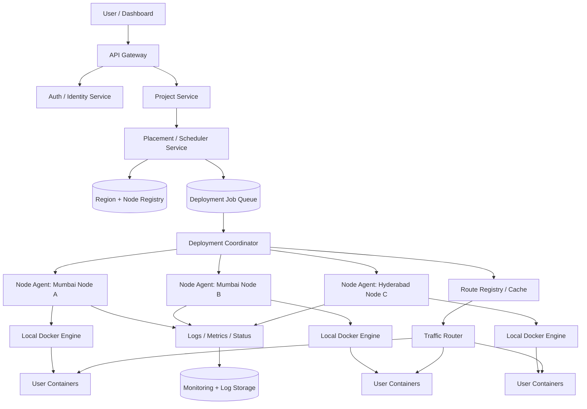
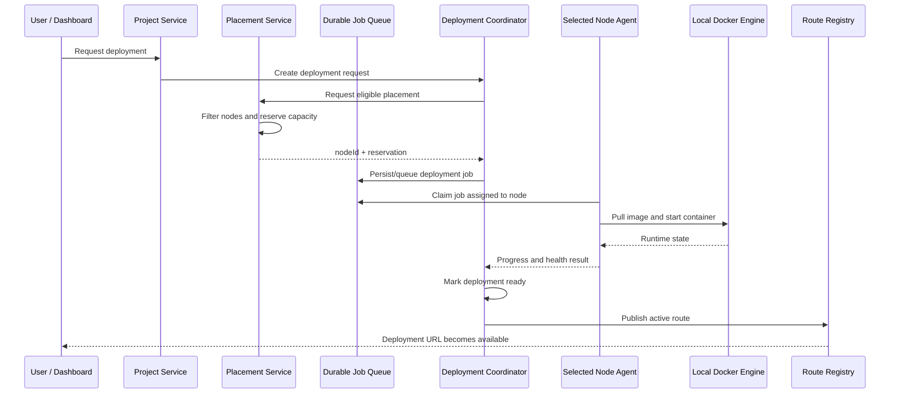

# DeployHub — Multi-Region Cloud Deployment Platform

> **Project type:** B.Tech CSE Pre-Final Year Team Project  
> **Project stage:** Existing single-server platform + new multi-server architecture under development  
> **Primary goal:** Let developers deploy static websites and backend applications without managing infrastructure manually.

---

## Table of Contents

- [DeployHub — Multi-Region Cloud Deployment Platform](#deployhub--multi-region-cloud-deployment-platform)
  - [Table of Contents](#table-of-contents)
  - [1. Project Overview](#1-project-overview)
    - [Product principles](#product-principles)
  - [2. Team](#2-team)
  - [3. Project History: Old and New Codebases](#3-project-history-old-and-new-codebases)
    - [Phase 1 — Prototype](#phase-1--prototype)
    - [Phase 2 — Microservices on one server](#phase-2--microservices-on-one-server)
    - [Phase 3 — New multi-server codebase](#phase-3--new-multi-server-codebase)
  - [4. Problem With the Original Single-Server Architecture](#4-problem-with-the-original-single-server-architecture)
  - [5. Goals of the New Architecture](#5-goals-of-the-new-architecture)
    - [Required first-stage capabilities](#required-first-stage-capabilities)
    - [Future capabilities](#future-capabilities)
  - [6. High-Level Architecture](#6-high-level-architecture)
    - [Important architecture rule](#important-architecture-rule)
  - [7. Service Responsibilities](#7-service-responsibilities)
    - [Avoid unnecessary microservices](#avoid-unnecessary-microservices)
  - [8. Node Agent Design](#8-node-agent-design)
    - [8.1 Purpose](#81-purpose)
    - [8.2 Responsibilities](#82-responsibilities)
    - [8.3 Suggested commands](#83-suggested-commands)
    - [8.4 Communication model](#84-communication-model)
    - [8.5 Agent process model](#85-agent-process-model)
    - [8.6 Language](#86-language)
  - [9. Regions, Nodes, and Placement](#9-regions-nodes-and-placement)
    - [9.1 Region versus node](#91-region-versus-node)
    - [9.2 Placement preferences](#92-placement-preferences)
    - [9.3 Placement algorithm — MVP](#93-placement-algorithm--mvp)
    - [9.4 Heartbeats and stale status](#94-heartbeats-and-stale-status)
  - [10. Project Creation and Deployment Flows](#10-project-creation-and-deployment-flows)
    - [10.1 Project creation](#101-project-creation)
    - [10.2 Deployment](#102-deployment)
    - [10.3 Build versus deploy](#103-build-versus-deploy)
  - [11. Core Data Models](#11-core-data-models)
    - [11.1 Project](#111-project)
    - [11.2 Region](#112-region)
    - [11.3 Node](#113-node)
    - [11.4 Deployment](#114-deployment)
    - [11.5 Deployment Job](#115-deployment-job)
    - [11.6 Node heartbeat/event](#116-node-heartbeatevent)
    - [11.7 Indexing and data integrity](#117-indexing-and-data-integrity)
  - [12. Service-to-Service Communication](#12-service-to-service-communication)
    - [API examples (illustrative)](#api-examples-illustrative)
  - [13. Deployment Lifecycle and State Model](#13-deployment-lifecycle-and-state-model)
    - [Deployment states](#deployment-states)
    - [Node states](#node-states)
    - [Job states](#job-states)
    - [Idempotency and retries](#idempotency-and-retries)
  - [14. Routing, Domains, and Cache Invalidation](#14-routing-domains-and-cache-invalidation)
  - [15. Logs, Metrics, and Health](#15-logs-metrics-and-health)
    - [Logs](#logs)
    - [Metrics](#metrics)
    - [Health checks](#health-checks)
  - [16. Security Requirements](#16-security-requirements)
  - [17. Failure Handling and Recovery](#17-failure-handling-and-recovery)
  - [18. Recommended Technology Choices](#18-recommended-technology-choices)
  - [19. Repository Structure: Existing Codebase](#19-repository-structure-existing-codebase)
    - [Existing code observations](#existing-code-observations)
  - [20. New Codebase: Suggested Structure](#20-new-codebase-suggested-structure)
  - [21. Implementation Roadmap](#21-implementation-roadmap)
    - [Phase 0 — Contracts and foundations](#phase-0--contracts-and-foundations)
    - [Phase 1 — Region and Node Registry](#phase-1--region-and-node-registry)
    - [Phase 2 — Node Agent MVP](#phase-2--node-agent-mvp)
    - [Phase 3 — Placement and reservations](#phase-3--placement-and-reservations)
    - [Phase 4 — Durable deployment workflow](#phase-4--durable-deployment-workflow)
    - [Phase 5 — Routing and logs](#phase-5--routing-and-logs)
    - [Phase 6 — Multi-node and failure tests](#phase-6--multi-node-and-failure-tests)
    - [Phase 7 — Gradual migration](#phase-7--gradual-migration)
  - [22. Testing and Acceptance Criteria](#22-testing-and-acceptance-criteria)
    - [Node Agent](#node-agent)
    - [Placement](#placement)
    - [Deployment and routing](#deployment-and-routing)
    - [Security](#security)
  - [23. Operational Principles](#23-operational-principles)
  - [24. Glossary](#24-glossary)
  - [25. Current Status and Open Decisions](#25-current-status-and-open-decisions)
    - [Known current status](#known-current-status)
    - [Decisions to finalize before production](#decisions-to-finalize-before-production)
  - [Final Summary](#final-summary)

---

## 1. Project Overview

**DeployHub** is a cloud deployment platform where users can connect or upload a project and deploy it to infrastructure managed by DeployHub. The initial product supports static websites and backend applications. Database hosting and additional platform capabilities may be introduced in the future.

The long-term direction is a platform that can manage multiple servers across multiple regions. Users should not need to know which physical server runs their application. They should be able to choose a preferred region—or allow DeployHub to choose one—and the platform should place the deployment on a suitable healthy node.

### Product principles

- **Developer experience:** Make deployment understandable and straightforward.
- **Placement abstraction:** Users choose a region preference, not a server's private IP address.
- **Reliable deployment:** A deployment should have a durable record and an observable lifecycle.
- **Separation of concerns:** Project configuration, scheduling, building, runtime operations, routing, and monitoring have distinct responsibilities.
- **Security by default:** Do not expose Docker's privileged API publicly; authenticate service and agent communication.
- **Incremental migration:** Keep the existing single-server platform stable while the new architecture is built and tested separately.

## 2. Team

This is a B.Tech CSE pre-final-year project with five team members.

1. **Rahul Kumar** — Team Leader; created the first prototype.
2. **Karishma Choudhary**
3. **Kunal Kumar Rajak**
4. **Dipak Jena**
5. **Harash Raj Tiwari**

Team responsibilities can be assigned by service, but every service should have an owner, API contract, tests, and deployment notes.

## 3. Project History: Old and New Codebases

### Phase 1 — Prototype

Rahul created an initial working prototype in approximately 15 days using a **monolithic Node.js architecture**. The prototype demonstrated the main deployment workflow.

### Phase 2 — Microservices on one server

The prototype was then split into multiple services. The existing codebase contains components such as:

- API Gateway
- Identity/Auth Service
- Project Service
- Build Service
- Deploy Service
- Monitoring Service
- Notification Service
- Analytics Service
- Admin Service
- Secrets Manager
- Stream Service
- Agent Service
- Platform and user routers
- Frontend, dashboard, and admin interfaces
- Shared libraries for Docker, Git, Redis, queues, secrets, and routing

Although the application is organized as microservices, the operational model is still primarily **single-server oriented**. Several services and deployment utilities assume that the Docker Engine, local files, ports, router configuration, or containers they need are available on the same machine or on a shared environment.

### Phase 3 — New multi-server codebase

A separate codebase is being designed to support multiple servers and regions properly. The new system should not simply run a copy of the old code on every server. It needs a shared control plane and a local agent on each server that can host user workloads.

**Migration strategy:** Do not replace the working production platform all at once. Build and validate the new system independently, then migrate features and workloads gradually after compatibility and recovery behavior are tested.

## 4. Problem With the Original Single-Server Architecture

A service can be a microservice and still depend on a single server. Microservices alone do not provide multi-server coordination.

Examples of problems when the old system is copied onto multiple machines:

1. **Local Docker assumption:** A deployment service may call its local Docker Engine, while the user's app actually runs on another server.
2. **Local filesystem assumption:** Build artifacts or uploaded files may exist on one machine but not on another.
3. **Local port allocation:** Two machines may allocate the same port independently, and the control plane may not know which port/container belongs to which node.
4. **Missing shared placement state:** If a project is deployed on Node A, Node B may not know that placement unless there is a shared deployment registry.
5. **Routing inconsistency:** A router on one machine may have stale or incomplete domain-to-deployment information.
6. **Inconsistent logs and status:** The service receiving a status request may not be able to inspect a container on another machine.
7. **Failure recovery:** A node failure needs detection and a defined recovery process; it cannot be solved by copying the service to another server.
8. **Duplicate work:** Retries or multiple workers may accidentally deploy the same job more than once without idempotency and locking/reservation.
9. **Capacity conflicts:** Two simultaneous requests may both see the same free capacity unless placement is reserved atomically.
10. **Secrets and credentials:** Giving every service unrestricted access to every server's Docker socket or SSH credentials creates a serious security risk.

The new architecture must make placement, deployment state, runtime ownership, and routing explicit.

## 5. Goals of the New Architecture

### Required first-stage capabilities

- Register each app-hosting node with a stable `nodeId`.
- Associate every node with a `regionId`.
- Track node health and approximate available capacity.
- Let Project Service store a user's region preference.
- Let Placement/Scheduler select a suitable node using current registry data.
- Reserve capacity before dispatching a deployment.
- Use a Node Agent to perform local runtime operations.
- Track each deployment independently from the project.
- Return deployment status and logs through central APIs.
- Route traffic to the correct healthy deployment.
- Authenticate agents and services.
- Support safe retries and recover from temporary control-plane/network outages.

### Future capabilities

- Multiple replicas per deployment.
- Autoscaling and load balancing.
- Cross-region failover.
- More build workers and isolated build environments.
- Managed databases and other services.
- Advanced placement based on latency, cost, plan, CPU/RAM, architecture, and workload.
- Kubernetes or another orchestrator if operating a custom node-agent platform becomes too costly.

These future features should not be treated as completed until implemented and tested.

## 6. High-Level Architecture

The architecture has two logical parts:

- **Control plane:** Stores desired configuration, selects placement, coordinates jobs, manages deployments, and updates routing metadata.
- **Runtime/data plane:** Runs user workloads on nodes and routes end-user traffic to those workloads.



### Important architecture rule

Project Service should **not** directly connect to every server's Docker Engine. It should ask the Placement Service for an allocation or submit a deployment request. The Deployment Coordinator dispatches an authorized job to the selected node's agent.

## 7. Service Responsibilities

| Component | Responsibility | Must not become responsible for |
|---|---|---|
| API Gateway | Public API entry, authentication integration, rate limits, request tracing, routing to services | Selecting a runtime node or operating Docker |
| Auth / Identity Service | Users, sessions, credentials, token issuance and identity | Project placement |
| Project Service | Project configuration, ownership, build settings, region preference, environment-variable references | Inspecting every server's Docker Engine |
| Region / Node Registry | Region and node records, capabilities, heartbeats, health and capacity snapshots | Executing deployments |
| Placement / Scheduler Service | Filtering and selecting a suitable node; capacity reservation; fallback policy | Building user source code or serving user traffic |
| Build Service / Build Workers | Clone source, build artifacts/images in an isolated environment, store/publish artifacts | Owning long-term runtime placement |
| Deployment Coordinator | Durable deployment jobs, state transitions, retries, cancellation, agent dispatch and result handling | Directly assuming every node's local filesystem is shared |
| Node Agent | Local Docker operations, node heartbeat, runtime status, log collection and job result reporting | Arbitrary shell execution from untrusted requests |
| Traffic Router | Resolve domain/hostname to an active deployment endpoint; apply routing changes | Making placement decisions on every request |
| Monitoring / Log Service | Store and query health, logs, metrics and events | Owning container lifecycle |
| Notification Service | Send deployment and system notifications | Changing deployment state without authorization |
| Secrets Manager | Securely store and deliver secrets to authorized workloads/services | Logging secret values |
| Admin Service | Administrative views, audit history and controlled operations | Bypassing service authorization |
| Analytics Service | Aggregated product and usage metrics | Becoming the source of truth for live placement |

### Avoid unnecessary microservices

Initially, Region Registry and Placement/Scheduler can be modules in one service if that is simpler. They do not need separate deployable services until independent scaling, ownership, or availability requirements justify it. Do not create a separate service for every region at the beginning.

## 8. Node Agent Design

### 8.1 Purpose

A **Node Agent** is a small, supervised service installed on every server that is allowed to run DeployHub user workloads. It communicates outward to the control plane and operates the local Docker Engine.

One agent software package should be reused across all nodes. Per-node configuration identifies the node and region; it should not require a different codebase for Mumbai, Hyderabad, or any other region.

### 8.2 Responsibilities

- Authenticate and register the node.
- Send periodic heartbeat and capacity/health snapshots.
- Receive authorized jobs intended for that specific node.
- Pull a trusted image or retrieve a build artifact.
- Create, start, stop, restart, and remove containers.
- Inspect container state and health checks.
- Stream or forward container stdout/stderr logs.
- Report job progress, errors, exit codes, and final status.
- Recover its control-plane connection after temporary network outages.
- Reconcile its local runtime inventory with known deployment assignments.
- Reject expired, malformed, unauthorized, or duplicate commands.
- Apply resource limits and approved runtime settings.
- Support graceful shutdown and agent upgrades.

### 8.3 Suggested commands

Commands should be typed, validated operations—not arbitrary shell commands.

| Operation | Purpose |
|---|---|
| `DEPLOY` | Pull an approved image and create/start a workload |
| `STOP` | Stop a specific deployment's container |
| `RESTART` | Restart an authorized deployment |
| `DELETE` | Remove a deployment's container after validation |
| `GET_STATUS` | Return runtime state and health |
| `STREAM_LOGS` | Stream bounded, authorized logs |
| `REPORT_HEALTH` | Report node and runtime health |
| `RECONCILE` | Compare local containers with control-plane assignments |

Every command should include a unique `jobId`, target `nodeId`, `deploymentId`, issue time/expiry, and trace/correlation ID. Commands that change state must be idempotent or protected by deduplication. Deleting a container must not automatically delete persistent volumes or user data unless an explicit, separately authorized data-deletion workflow requests it.

### 8.4 Communication model

Recommended initial approach:

1. Agent establishes an **outbound authenticated TLS connection** to the control plane.
2. Agent polls for jobs or maintains a long-lived stream.
3. Agent reports progress and results over the authenticated connection.
4. Control plane validates node identity and only dispatches jobs assigned to that node.

Polling is simpler for an MVP. gRPC streaming or WebSockets can be introduced if lower command latency or high-throughput status updates become necessary. A private VPN can be added when private node-to-node connectivity is needed.

**Never expose an unauthenticated Docker TCP API to the public internet.** Access to the Docker socket is highly privileged and should be isolated and carefully controlled.

### 8.5 Agent process model

Run the agent as a supervised Linux service (for example, systemd). It should have:

- Unique node identity and rotated credentials.
- A configuration file or environment-based configuration.
- Structured logs with secret redaction.
- Request/job timeouts and bounded retries.
- A bounded local queue for temporary disconnection, where appropriate.
- Version reporting and a controlled upgrade process.
- Minimal filesystem permissions and resource limits.

### 8.6 Language

Go is a strong candidate for a small, distributable Linux agent. Node.js can also work if it matches team skills better. The protocol between the agent and control plane should be language-independent. Choose one language for the MVP rather than maintaining two agent implementations.

## 9. Regions, Nodes, and Placement

### 9.1 Region versus node

- **Region:** A geographic/provider region, such as Mumbai or Hyderabad.
- **Availability zone:** An isolated zone within a provider region, if the provider exposes zones.
- **Node:** One concrete VM or server that can run user workloads.
- **Node Agent:** The process running on that node.
- **Deployment:** One specific release/version of a project.
- **Runtime instance:** A running copy of a deployment; useful if replicas are added later.

A region is not a server. One region can contain many nodes.

### 9.2 Placement preferences

A project's placement configuration may look like this:

```json
{
  "policy": "auto",
  "preferredRegionId": "region-mumbai",
  "preferredNodeId": null,
  "allowFallback": true
}
```

Suggested meaning:

- `auto`: Scheduler selects a region/node based on allowed policy.
- `pinned`: Enforce a region constraint if the product offers that option.
- `preferredRegionId`: A preference, not necessarily a guarantee.
- `preferredNodeId`: Optional node preference; avoid making it a permanent constraint unless required.
- `allowFallback`: Whether another region may be selected if the preferred region has no eligible capacity.

A user-selected region should not imply a permanent server assignment. Node health and capacity change. The actual placement belongs to a Deployment record.

### 9.3 Placement algorithm — MVP

For each request:

1. Validate the requested region and the user's plan/policy.
2. Fetch candidate nodes in that region.
3. Exclude nodes that are disabled, draining, unhealthy, stale, incompatible, or at capacity.
4. Check resource requirements: CPU, memory, disk, architecture and supported runtime.
5. Rank remaining candidates using a simple policy (available capacity, current load, or least allocated resources).
6. Atomically reserve the required capacity with a lease/expiry.
7. Persist the selected node and deployment/job assignment.
8. Dispatch the job.
9. If no node is eligible, either try an allowed fallback region or return a clear `NO_CAPACITY` result.
10. Release reservation on failure/cancellation, and reconcile reservations after crashes.

**Concurrency requirement:** Two simultaneous placement requests must not both consume the same remaining capacity. Use a transactional/atomic reservation or another coordination mechanism. A periodically refreshed capacity snapshot alone is not sufficient.

### 9.4 Heartbeats and stale status

Agents report heartbeats and capacity periodically. The Registry tracks `lastHeartbeatAt`. If heartbeat age exceeds a configured threshold, mark the node `unknown` or `unhealthy` and stop assigning new deployments until it recovers. The thresholds should be configuration, not hard-coded assumptions.

## 10. Project Creation and Deployment Flows

### 10.1 Project creation

1. User signs in through Auth/Identity Service.
2. API Gateway validates the user's identity.
3. Project Service validates input and ownership.
4. Project Service saves project configuration, including region preference and build settings.
5. Project Service returns the created project ID.
6. If creation also triggers a first deployment, it creates or publishes a deployment request through the deployment workflow.

Project creation and deployment do not have to be one synchronous operation. A project can exist before its first deployment.

### 10.2 Deployment



The exact queue/dispatch implementation may differ. The essential requirements are durable jobs, explicit node assignment, authenticated agent communication, observable state, and a health check before traffic is switched.

### 10.3 Build versus deploy

Build and runtime deployment are separate concerns:

- Build workers clone source and build artifacts/images in an isolated environment.
- Artifacts/images should be stored in a registry or object store reachable by the selected node.
- The Node Agent should usually pull an approved image and run it rather than building arbitrary source directly on a production runtime node.
- If an early MVP builds on the node, document that limitation and plan isolation/resource controls.

## 11. Core Data Models

These are **conceptual starting schemas**, not final production schemas. Adapt names and constraints to the selected database.

### 11.1 Project

Stores desired configuration and ownership.

```js
{
  _id,
  userId,
  name,
  type,                 // static | node | go | python | java
  status,               // project-level lifecycle only
  repoUrl,
  branch,
  rootDirectory,
  buildCommand,
  publishDir,
  startCommand,
  envSecretRefs,        // references, not plaintext secret values
  placement: {
    policy: "auto",
    preferredRegionId: null,
    preferredNodeId: null,
    allowFallback: true
  },
  plan,
  createdAt,
  updatedAt
}
```

Do not use a Project document as the only record of every deployment attempt. Keep deployment-specific runtime state in a separate collection/table.

### 11.2 Region

```js
{
  _id,
  code,                 // provider/DeployHub stable code
  name,                 // e.g. Mumbai
  provider,
  status,               // active | maintenance | disabled
  createdAt,
  updatedAt
}
```

### 11.3 Node

```js
{
  _id,
  nodeId,               // stable unique identity
  regionId,
  zoneId,
  provider,
  status,               // provisioning | healthy | draining | unhealthy | disabled
  endpointRef,          // private endpoint/service-discovery reference
  capabilities: {
    runtimes: ["docker"],
    architectures: ["amd64"]
  },
  capacity: {
    cpuTotal: 8,
    memoryMbTotal: 16384,
    diskMbTotal: 200000,
    cpuReserved: 0,
    memoryMbReserved: 0
  },
  observed: {
    cpuUsagePercent: null,
    memoryUsagePercent: null,
    diskUsagePercent: null,
    runningDeployments: 0
  },
  lastHeartbeatAt,
  agentVersion,
  createdAt,
  updatedAt
}
```

Capacity figures above are examples. Keep reported/observed usage separate from reserved capacity. Never trust an agent's unauthenticated self-reported identity.

### 11.4 Deployment

```js
{
  _id,
  projectId,
  userId,
  version,
  sourceRevision,
  buildId,
  imageRef,
  status,
  regionId,
  nodeId,
  runtime: {
    containerId: null,
    internalPort: null,
    healthStatus: "unknown"
  },
  failure: {
    code: null,
    message: null
  },
  createdAt,
  startedAt: null,
  readyAt: null,
  endedAt: null
}
```

### 11.5 Deployment Job

```js
{
  _id,
  jobId,
  deploymentId,
  nodeId,
  operation,            // DEPLOY | STOP | RESTART | DELETE | GET_STATUS
  status,               // pending | leased | running | succeeded | failed
  attempt: 0,
  idempotencyKey,
  leaseExpiresAt,
  createdAt,
  updatedAt
}
```

### 11.6 Node heartbeat/event

Heartbeat snapshots can be stored as a latest-state record and optionally as time-series events. Avoid writing excessively frequent full metrics into the main Node document if the fleet grows; use a metrics system for high-volume telemetry.

### 11.7 Indexing and data integrity

At minimum, consider unique indexes for `nodeId`, region code, `jobId`, and idempotency keys; indexes for deployments by project and creation time; and indexes for nodes by region/status. Final index design depends on query patterns. Validate references and define retention policies for logs/events.

## 12. Service-to-Service Communication

Use synchronous HTTP/gRPC for request-response operations and a durable queue for long-running work.

| Interaction | Suggested mechanism |
|---|---|
| Dashboard → API Gateway | HTTPS |
| Gateway → internal services | Authenticated HTTP/gRPC |
| Project → Placement | Internal authenticated API |
| Deployment Coordinator → job queue | Durable queue |
| Node Agent → control plane | Outbound TLS polling or authenticated stream |
| Agent → local Docker | Local Docker API/socket with strict host-level controls |
| Logs → logging backend | Bounded streaming/batched ingestion |
| Route updates → routers | Versioned registry update, pub/sub, or cache invalidation |

The current codebase already contains RabbitMQ/Redis-related utilities in places. Reuse existing infrastructure only after confirming its delivery guarantees, failure behavior, and ownership. Do not use Redis Pub/Sub alone as the only durable deployment-job queue: Pub/Sub messages are not a durable job history.

### API examples (illustrative)

**Request placement:**

```http
POST /internal/v1/placements
Authorization: Bearer <service-token>
Content-Type: application/json
```

```json
{
  "deploymentId": "dep_123",
  "preferredRegionId": "region-mumbai",
  "allowFallback": true,
  "requirements": {
    "cpuMillicores": 500,
    "memoryMb": 512
  }
}
```

**Possible response:**

```json
{
  "reservationId": "res_456",
  "regionId": "region-mumbai",
  "nodeId": "node_mum_01",
  "expiresAt": "2026-10-24T12:05:00Z"
}
```

This response means placement is reserved; it does not mean the application is already running or healthy.

## 13. Deployment Lifecycle and State Model

Keep project, deployment, job, and node statuses separate.

### Deployment states

A suggested lifecycle is:

`queued → scheduling → assigned → building → deploying → health_check → ready`

Failure/exit states may include `failed`, `cancelled`, and `stopped`. Exact transitions should be validated centrally. Do not allow arbitrary transitions just because an API request asks for them.

### Node states

Suggested states:

- `provisioning`
- `healthy`
- `draining`
- `unknown`
- `unhealthy`
- `disabled`

A node in `draining` accepts no new deployments but may finish or migrate existing workloads according to policy.

### Job states

Suggested states:

- `pending`
- `leased`
- `running`
- `succeeded`
- `failed`
- `cancelled`
- `retry_wait`

### Idempotency and retries

- A retry must not accidentally create a second container for the same deployment.
- Store a stable deployment/job identity and reconcile with container labels.
- Use bounded retries, exponential backoff with jitter, and dead-letter/manual review for repeated failures.
- Acknowledge queue messages only after the job state is safely persisted.
- Define how to recover if the agent starts a container but loses the network before reporting success.

## 14. Routing, Domains, and Cache Invalidation

The router should resolve a hostname to the currently active deployment endpoint. It should not call the scheduler for every user request.

Suggested flow:

1. Deployment becomes healthy.
2. Deployment Coordinator publishes a versioned route record.
3. Route registry/cache is updated or invalidated.
4. Router begins sending traffic to the new healthy endpoint.
5. During redeploy, keep the old healthy version active until the new one passes health checks.
6. On stop/delete/failure, remove or deactivate the route according to policy.

Route metadata may include hostname, deployment ID, region/node reference, internal endpoint, target port, health state, and revision. Do not expose private node endpoints to the public client.

Use TTL as a safety net, not as the only invalidation mechanism. Route changes should be explicit, versioned, and observable. If the route cache is stale, routers should have defined behavior rather than forwarding to a known-dead node indefinitely.

## 15. Logs, Metrics, and Health

### Logs

- Collect container stdout/stderr.
- Tag records with `projectId`, `deploymentId`, `nodeId`, timestamp, stream, and severity where available.
- Provide bounded streaming and pagination.
- Apply retention limits and access control.
- Redact credentials and secrets; never log environment-variable values.
- Decide how logs behave when the node is offline and whether local buffering is needed.

### Metrics

Track at least:

- Node CPU, memory and disk usage.
- Available/reserved capacity.
- Agent heartbeat age and version.
- Running containers/deployments.
- Deployment queue age and failure rate.
- Build duration and deployment duration.
- Health-check failures.
- Router errors and stale-route events.

Use a dedicated metrics system if telemetry volume grows. Avoid making the main project database a high-frequency metrics time-series store.

### Health checks

Differentiate:

- **Liveness:** Is the process alive?
- **Readiness:** Can it safely accept work?
- **Node health:** Is the host and Docker runtime usable?
- **Application health:** Is the deployed application responding correctly?

A running container is not automatically a healthy application.

## 16. Security Requirements

Security is a release requirement, not a later polish task.

1. Never expose Docker's privileged API/socket to the public internet.
2. Authenticate agents using unique per-node credentials or certificates; support rotation and revocation.
3. Use TLS for all network communication; consider mTLS for agent-to-control-plane traffic.
4. Authorize every operation by node, deployment, project, and tenant.
5. Do not implement arbitrary shell execution as a general-purpose agent command.
6. Validate image references, ports, mount paths, resource limits, and all command parameters.
7. Run user workloads with least privilege; avoid privileged containers and host filesystem mounts by default.
8. Isolate build workloads from the control plane and from other users' workloads.
9. Store secrets in a secrets manager or encrypted store and deliver only to authorized deployments.
10. Never include secret values in logs, error responses, or tracing metadata.
11. Apply rate limits and payload-size limits to public APIs and agent endpoints.
12. Record audit events for deploy, stop, restart, delete, credential rotation, and administrative actions.
13. Protect against replay and duplicate commands using expiry, job IDs, and idempotency.
14. Treat user-supplied repositories, Dockerfiles, build scripts, and runtime code as untrusted.
15. Use backups, recovery tests, dependency updates, and vulnerability scanning.

A Node Agent that can access Docker is highly privileged. Restrict its permissions and network access; consider stronger isolation as the platform matures.

## 17. Failure Handling and Recovery

| Failure | Expected behavior |
|---|---|
| Agent heartbeat becomes stale | Mark node unknown/unhealthy; stop new placements |
| Node has insufficient capacity | Do not reserve it; try another eligible node |
| Preferred region has no capacity | Use fallback only if policy allows; otherwise return a clear no-capacity result |
| Agent disconnects mid-job | Job lease expires; reconcile runtime state before retrying |
| Duplicate job delivered | Idempotency prevents duplicate side effects |
| Image pull/build fails | Mark deployment failed with a safe, useful error; release reservation |
| Container starts but health check fails | Keep it out of active routing; retry or fail according to policy |
| Node crashes | Mark it unhealthy; alert and apply an explicit recovery policy |
| Router has stale metadata | Refresh/revalidate route; avoid knowingly sending traffic to dead endpoints |
| Deployment delete requested | Authorize ownership; stop/remove only the target workload; preserve data unless separately authorized |
| Registry/database temporarily unavailable | Fail closed for new placement rather than guessing capacity |
| Region outage | Use cross-region fallback only if allowed and required artifacts/secrets/data are available |

**Important:** Recreating a container on another node is not the same as moving all application state. Persistent volumes, databases, uploads, and local files require an explicit storage and recovery design. Do not promise automatic failover until those dependencies are handled.

## 18. Recommended Technology Choices

These are recommendations, not claims about components already implemented.

| Area | Practical starting choice |
|---|---|
| Existing services | Keep the team's current Node.js stack where it is productive |
| Node Agent | Go is a strong option for a portable, static Linux binary; Node.js is also possible |
| Runtime | Docker Engine for the first implementation |
| Database | MongoDB can store projects, nodes, deployments, and jobs if consistency needs are designed carefully |
| Durable jobs | RabbitMQ or another durable queue with acknowledgements, retries, and dead-letter handling |
| Fast-changing route/status cache | Redis can help, but the persistent database/registry remains the source of truth |
| Build artifacts/images | Container registry and/or object storage |
| Service communication | HTTPS initially; gRPC streaming where it materially helps |
| Private connectivity | Outbound TLS first; VPN/private networking when required |
| Process supervision | systemd on Linux nodes |
| Logs and metrics | Existing monitoring stack initially; dedicated observability tooling as volume grows |
| Deployment packaging | Docker for services; signed/versioned agent release artifacts |

Do not introduce Kubernetes, Kafka, a separate database per region, or one microservice per region just for the appearance of scale. Adopt them when a measurable operational requirement justifies the added complexity.

## 19. Repository Structure: Existing Codebase

The supplied existing repository has a broad structure similar to the following. This is a **high-level guide**, not a guarantee that every path or feature is active in production.

```text
deploy-micro/
├── backend/
│   ├── api-gateway/
│   ├── services/
│   │   ├── admin-service/
│   │   ├── agent-service/
│   │   ├── analytics-service/
│   │   ├── build-service/
│   │   ├── deploy-service/
│   │   ├── identity-service/
│   │   ├── monitoring-service/
│   │   ├── notification-service/
│   │   ├── project-service/
│   │   ├── secrets-manager/
│   │   └── stream-service/
│   ├── shared/
│   │   ├── cache/
│   │   ├── constants/
│   │   ├── docker/
│   │   ├── errors/
│   │   ├── git/
│   │   ├── middlewares/
│   │   ├── nginx/
│   │   ├── queues/
│   │   ├── redis/
│   │   ├── secrets/
│   │   └── utils/
│   ├── Dockerfile
│   └── .dockerignore
├── frontend/
│   ├── frontend/
│   ├── Dasboard-Frontend/
│   ├── Dashboard-Revamp/
│   └── admin/
├── routers/
│   ├── platform-router/
│   └── user-router/
└── .github/
    └── workflows/
```

### Existing code observations

- The codebase includes local Docker utilities and deploy workers, so their assumptions need to be reviewed before using them across multiple hosts.
- Build service utilities include image/artifact handling and object-storage integration.
- Redis and RabbitMQ utilities exist in parts of the backend. Confirm which queues are durable and which channels are only for notifications.
- Stream and monitoring services already exist in the repository; reuse their API concepts where appropriate, but make sure they can resolve a deployment on any node.
- The old codebase is a reference for features and compatibility—not the architecture template to copy blindly into the new system.

## 20. New Codebase: Suggested Structure

A possible starting structure for the new multi-server implementation:

```text
deployhub-platform/
├── apps/
│   ├── api-gateway/
│   ├── auth-service/              # completed in new codebase
│   ├── project-service/           # currently being developed
│   ├── placement-service/         # registry + scheduling to start simply
│   ├── deployment-service/        # durable deployment lifecycle and jobs
│   ├── build-service/             # isolated build and artifact/image creation
│   ├── routing-service/           # route registry and router updates
│   ├── logs-service/              # centralized logs
│   └── monitoring-service/
├── agent/
│   └── node-agent/                # one reusable agent installed per host
├── packages/
│   ├── contracts/                 # API schemas and event definitions
│   ├── auth-client/
│   ├── logger/
│   └── errors/
├── infrastructure/
│   ├── local-dev/
│   ├── docker/
│   └── deployment/
├── docs/
│   ├── architecture.md
│   ├── api-contracts.md
│   ├── node-agent.md
│   ├── security.md
│   └── runbooks/
└── README.md
```

Do not create all these services as separate deployables immediately. Keep the boundaries clear in code, but combine modules where appropriate until independent deployment/scaling is needed. The Node Agent is a separate process because it must run on each workload host.

## 21. Implementation Roadmap

### Phase 0 — Contracts and foundations

- [ ] Agree on IDs and naming for projects, deployments, nodes, regions, jobs, and reservations.
- [ ] Define API schemas and deployment state transitions.
- [ ] Define service-to-service authentication.
- [ ] Choose the durable queue and document retry/acknowledgement semantics.
- [ ] Define what the first supported project types and runtime requirements are.

### Phase 1 — Region and Node Registry

- [ ] Create Region model and seed configured regions.
- [ ] Create Node model with stable node ID and region ID.
- [ ] Add authenticated node registration.
- [ ] Add heartbeat endpoint/stream.
- [ ] Track last heartbeat and stale-node status.
- [ ] Report basic capacity and capabilities.
- [ ] Add admin visibility into nodes and health.

### Phase 2 — Node Agent MVP

- [ ] Create one agent binary/process reusable across all nodes.
- [ ] Load `nodeId`, region identity and credentials securely.
- [ ] Establish outbound TLS communication.
- [ ] Register and heartbeat.
- [ ] Receive a harmless test job and acknowledge it.
- [ ] Implement `GET_STATUS`.
- [ ] Implement `DEPLOY` from a trusted test image.
- [ ] Implement `STOP` and `RESTART`.
- [ ] Report progress and final result.
- [ ] Add structured logs, bounded retries and graceful shutdown.
- [ ] Install as a supervised service on a test node.

### Phase 3 — Placement and reservations

- [ ] Project Service stores region preference and fallback policy.
- [ ] Placement filters nodes by region, health, compatibility and capacity.
- [ ] Add atomic capacity reservations with expiry.
- [ ] Add deterministic selection policy and clear `NO_CAPACITY` errors.
- [ ] Test simultaneous allocation requests.
- [ ] Persist actual node/region on the Deployment record.

### Phase 4 — Durable deployment workflow

- [ ] Create a deployment record before execution.
- [ ] Queue jobs durably and assign each job to one node.
- [ ] Add idempotency and duplicate-delivery protection.
- [ ] Make the agent pull a trusted image/artifact.
- [ ] Add application health checks.
- [ ] Release reservations correctly on success, failure and cancellation.
- [ ] Add a reconciliation process for interrupted jobs.

### Phase 5 — Routing and logs

- [ ] Publish a route only after the deployment is healthy.
- [ ] Version route records and implement cache invalidation.
- [ ] Ensure router can reach the selected node securely.
- [ ] Add centralized logs with project/deployment/node identifiers.
- [ ] Add authorization and retention limits for logs.
- [ ] Test redeploy with no downtime where the runtime design supports it.

### Phase 6 — Multi-node and failure tests

- [ ] Run two agents on two separate servers.
- [ ] Deploy to one node and verify the other node sees the shared deployment state through the control plane.
- [ ] Fill one node and verify placement chooses another eligible node.
- [ ] Stop an agent and verify it becomes stale/unhealthy.
- [ ] Kill a deployment job midway and test reconciliation.
- [ ] Verify that duplicate jobs do not create duplicate containers.
- [ ] Test region fallback policy.
- [ ] Test route changes, delete operations and secret redaction.

### Phase 7 — Gradual migration

- [ ] Keep the current platform serving its existing users.
- [ ] Choose a small test workload for the new platform.
- [ ] Run staging and security tests.
- [ ] Migrate a limited set of projects only after backups and rollback are ready.
- [ ] Monitor errors, latency, deployment success and resource usage.
- [ ] Expand gradually; keep a rollback path until confidence is established.

## 22. Testing and Acceptance Criteria

A feature is not complete merely because the happy path works.

### Node Agent

- Invalid credentials are rejected.
- Agent reconnects after temporary network loss.
- Duplicate job delivery does not duplicate side effects.
- Agent reports accurate container status.
- Logs are tagged to the correct deployment and secrets are redacted.
- Agent cannot execute arbitrary commands from untrusted input.
- Agent cannot operate a deployment assigned to a different node/tenant without explicit authorization.

### Placement

- Unhealthy or stale nodes are not selected.
- Region constraints are respected.
- Fallback occurs only when allowed.
- Concurrent allocations cannot exceed reserved capacity.
- Reservations expire and are reconciled after crashes.
- No eligible node produces a clear error rather than an unsafe guess.

### Deployment and routing

- A deployment is not routed before it passes health checks.
- Failed deployments do not replace the last healthy release automatically.
- Delete affects only the intended deployment.
- Router metadata updates are observable and eventually consistent within a documented bound.
- Node failure has a defined operational outcome and alert.
- Persistent data is not silently discarded during rescheduling.

### Security

- Docker API is not publicly exposed.
- Agent identity can be revoked and rotated.
- Public users cannot submit arbitrary privileged runtime parameters.
- Service-to-service calls are authenticated and authorized.
- Secrets are not included in logs or telemetry.

## 23. Operational Principles

- **Persist before dispatch:** A deployment request and job should be durable before an agent executes them.
- **Separate desired and actual state:** Project configuration expresses intent; Deployment records what happened.
- **Assume at-least-once delivery:** Design commands to be idempotent and reconcile partial work.
- **Use leases, not permanent locks:** Reservations and job claims should expire and be recoverable.
- **Do not trust stale capacity:** Heartbeats and reservations must be part of placement.
- **Do not route to an unhealthy deployment:** Readiness/health checks gate traffic changes.
- **Keep data separate from compute:** Moving a container does not move its persistent data.
- **Keep private addresses private:** Public routers should use controlled routing infrastructure, not leak node internals.
- **Prefer simple infrastructure until needed:** A single Placement Service can manage several regions at the start.
- **Document operational actions:** Node drain, credential rotation, failed deployment recovery, backups, and rollback need runbooks.

## 24. Glossary

| Term | Meaning |
|---|---|
| Control plane | Services that coordinate configuration, placement, deployment and routing updates |
| Data/runtime plane | Nodes that run user workloads and the routing layer that serves them |
| Region | Geographic/provider location containing nodes |
| Node | One server/VM eligible to run deployments |
| Node Agent | Local service on each node that performs authorized runtime operations |
| Placement | Selecting an eligible region/node for a deployment |
| Reservation | Temporary accounting claim on node capacity |
| Deployment | A specific version/release attempt for a project |
| Build artifact | Output of the build process, such as a static bundle or container image |
| Container image | Immutable package used to create a container |
| Container | Running instance created from an image |
| Heartbeat | Periodic signal showing an agent/node is reachable |
| Reconciliation | Comparing desired/control-plane state with actual runtime state and correcting discrepancies |
| Idempotency | Repeating an operation safely without repeating unintended side effects |
| Route registry | Mapping of hostnames/domains to active deployment endpoints |
| Fallback | Choosing an alternative eligible region/node when policy permits |

## 25. Current Status and Open Decisions

### Known current status

- The original DeployHub prototype was created as a Node.js monolith.
- The original platform was later separated into microservices but remains primarily single-server oriented.
- The old repository includes identity, project, build, deploy, monitoring, streaming, notifications, analytics, admin, routing and shared utilities.
- The new codebase is being developed separately to support multi-server and multi-region deployment.
- **Auth Service in the new codebase is reported complete.**
- **Project Service is currently being developed**, including project creation and region/server placement preferences.
- A reusable Node Agent is planned; it should handle local Docker operations, deployment status, logs, and node health.
- The new multi-region architecture is a target design. Features listed as roadmap items must not be assumed implemented until verified.

### Decisions to finalize before production

- [ ] Final language and packaging for Node Agent (Go or Node.js).
- [ ] Agent communication protocol (HTTPS polling first, or gRPC/WebSocket stream).
- [ ] Durable job queue and exact delivery semantics.
- [ ] Database ownership and consistency boundaries across services.
- [ ] Region fallback and data-residency policy.
- [ ] Capacity calculation and reservation strategy.
- [ ] Build isolation and container image registry.
- [ ] Router topology and route-cache invalidation strategy.
- [ ] Persistent storage and node-failure recovery model.
- [ ] Credential issuance, rotation, revocation, and audit process.
- [ ] Logs/metrics storage and retention policy.
- [ ] Deployment state transitions and rollback policy.

---

## Final Summary

DeployHub is evolving from a working single-server deployment platform into a multi-server, multi-region platform. The key architectural change is not merely running existing microservices on more machines. It is introducing shared placement state, a scheduler that reserves capacity, durable deployment records/jobs, a reusable Node Agent on every workload host, and routing that only targets healthy deployments.

The recommended next step is to finish the Project Service's placement preference contract, then build the Node Registry and a minimal Node Agent that can register, heartbeat, report status, and deploy a trusted test image. Validate this on two separate servers before expanding the platform.

**This README describes both the existing system and the intended target architecture. Keep the “Current Status” section updated as implementation progresses, and clearly mark planned functionality until it is verified.**
