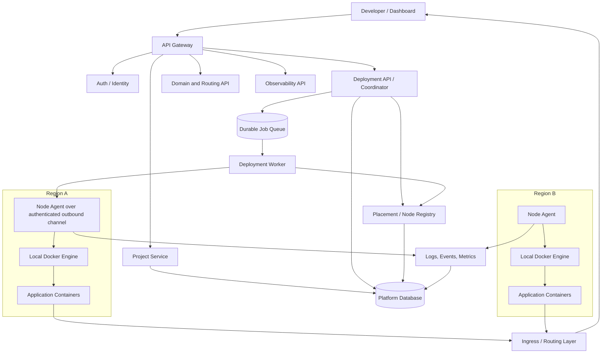
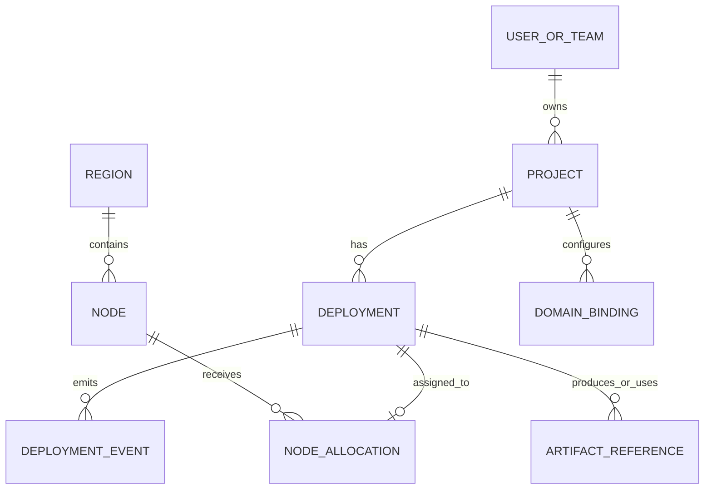
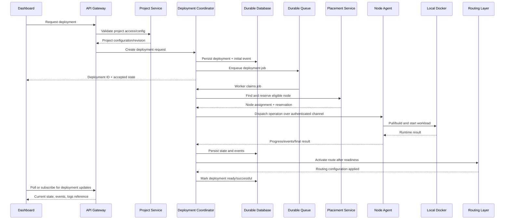
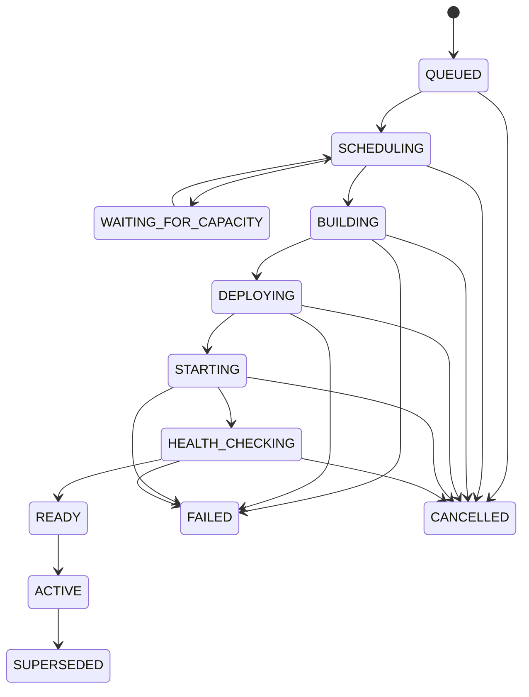

# DeployHub — Architecture Design Document

> **Audience:** DeployHub engineering team  
> **Document type:** System architecture and design reference  
> **Purpose:** Establish shared understanding of system boundaries, responsibilities, and operational behavior.

## How to use this document

This document defines the **intended system architecture for DeployHub**. It is written for developers who need to understand the complete platform before implementing, reviewing, or changing an individual service.

It covers system boundaries, service responsibilities, data ownership, request flows, deployment states, communication patterns, security, and failure recovery. It is an architecture reference—not a code walkthrough, API specification, or report of current implementation progress.

After reading this document, a developer should be able to explain:

- What happens from the moment a user creates a project until the application is running?
- Which service owns each decision and each piece of data?
- How does the platform choose a server in a region?
- How does a central service safely operate Docker on remote servers?
- How do deployment status, logs, domains, and health checks remain consistent?
- What happens when a node, agent, queue, or central service fails?

---

## Contents

1. [Product and system boundaries](#1-product-and-system-boundaries)
2. [Architecture principles](#2-architecture-principles)
3. [Main components and responsibilities](#3-main-components-and-their-responsibilities)
4. [Control plane and execution plane](#4-control-plane-and-execution-plane)
5. [Core entities and relationships](#5-core-entities-and-relationships)
6. [Project creation and deployment workflows](#6-project-creation-and-deployment-are-different-workflows)
7. [Placement and node selection](#7-placement-choosing-a-node-safely)
8. [Node Agent communication and security](#8-node-agent-communication-and-security)
9. [Deployment lifecycle and status model](#9-deployment-lifecycle-and-status-model)
10. [Release activation and routing](#10-release-activation-and-routing)
11. [Data ownership and persistence](#11-data-ownership-and-persistence)
12. [Reliability, retries, and reconciliation](#12-reliability-retries-and-reconciliation)
13. [Logs, events, metrics, and health](#13-logs-events-metrics-and-health)
14. [Security and trust boundaries](#14-security-and-trust-boundaries)
15. [Scaling strategy](#15-scaling-strategy)
16. [API and event contract guidelines](#16-api-and-event-contract-guidelines)
17. [Technology choices and decision records](#17-technology-choices-and-decision-records)
18. [End-to-end scenarios](#18-suggested-end-to-end-scenarios-for-team-review)
19. [Delivery approach](#19-delivery-approach)
20. [Architecture acceptance criteria](#20-acceptance-criteria-for-the-architecture)
21. [Glossary](#21-glossary)
22. [Final architectural agreement](#22-final-architectural-agreement)

---

## 1. Product and system boundaries

DeployHub is a platform that lets a developer connect a project, configure how it should be built and run, and deploy it without manually operating the underlying servers.

The platform has two broad parts:

1. **Control plane** — the central services that authenticate users, store project configuration, decide where an application should run, create and track deployment jobs, manage domains, and present status to users.
2. **Execution plane** — the servers that actually build and run application containers. Each managed server runs a Node Agent that performs approved operations on its own machine.

The control plane makes decisions. The execution plane carries them out and reports the results. This separation is the core architectural rule.

The diagram is logical, not a deployment mandate. Each box represents a responsibility; it does not necessarily require a separate process, repository, or database from day one. Components may initially run together, provided their boundaries, contracts, and data ownership remain explicit.

### 1.1 What the platform is responsible for

- Identity, authentication, authorization, and project ownership.
- Project configuration and deployment settings.
- Registering managed nodes and tracking their region, health, capacity, and agent connectivity.
- Selecting a suitable node for a deployment.
- Creating durable deployment jobs and coordinating their lifecycle.
- Asking the correct node agent to build, start, stop, restart, or remove an application.
- Tracking deployment outcomes and exposing status and logs to the dashboard.
- Associating domains with deployments and routing requests to healthy application instances.
- Applying security rules and auditing sensitive operations.

### 1.2 What the platform is not allowed to assume

- That all deployments run on one machine.
- That a project always stays on the same node or in the same region.
- That a local file path on the control plane exists on a worker node.
- That an in-memory queue or local cache is the source of truth.
- That a container being started means the application is healthy.
- That recreating a container automatically migrates or preserves application data.
- That a node is available merely because it was healthy a few minutes ago.

---

## 2. Architecture principles

These principles guide implementation decisions across all services.

### 2.1 Separate desired configuration from actual runtime state

A **Project** describes what the user wants: repository, build settings, environment configuration references, region preference, domains, and runtime settings.

A **Deployment** describes one attempt to turn a particular project revision into a running release. It records the source revision, selected node, build result, runtime result, timestamps, and final outcome.

The project is not the deployment, and a deployment is not the node. A project can have many deployments over time; a deployment is placed on a node; a node can host many deployments.

### 2.2 One owner for each decision

- Auth owns identity and authorization facts.
- Project Service owns project configuration.
- Placement / Node Registry owns node eligibility and placement decisions.
- Deployment Coordinator owns the deployment workflow and state transitions.
- Node Agent owns local execution on its own server.
- Routing / Domain Service owns domain-to-deployment routing configuration.
- Observability owns the collected logs, events, and metrics.

Other services may read data through defined APIs or events, but should not independently invent a competing version of the same state.

### 2.3 Durable state before external side effects

Before dispatching work to a node, persist the deployment and job state. If a process restarts, the system must be able to determine what was requested, what was dispatched, and whether the work needs to be retried or reconciled.

### 2.4 Assume messages can be delayed, duplicated, or lost

A queue can deliver a job more than once. An agent can finish an operation but lose its response. A worker can crash between two steps. Handlers therefore need idempotency, unique operation identifiers, timeouts, retries, and reconciliation.

### 2.5 Nodes are replaceable execution capacity

The control plane should be able to register a new node and use it without needing a new deployment service for that region. Region is metadata and a placement constraint, not a reason to duplicate the entire control plane.

### 2.6 Do not expose Docker as a public management API

The platform must not expose an unauthenticated Docker TCP socket to the internet. Remote execution should go through the authenticated Node Agent protocol. The agent validates requests and operates only on its own local Docker Engine.

### 2.7 Make user-visible status derive from persisted state

Dashboard status must come from the deployment state model and reported events, not from a worker's temporary memory or a stale frontend cache.

---

## 3. Main components and their responsibilities

Logical components may initially share a process or deployment unit. Their responsibilities, contracts, and ownership must nevertheless remain distinct.

### 3.1 Dashboard / Client

The dashboard is the user interface. It allows users to create projects, set configuration, request deployments, view build and runtime logs, inspect deployment history, configure domains, and see health/status.

The dashboard must not decide which node runs a deployment. It requests an operation from the API and displays the result returned by the platform.

### 3.2 API Gateway

The gateway is the public entry point for client API traffic. It performs request routing and cross-cutting checks such as request IDs, rate limits, and authentication-token validation where appropriate.

It should not own project data, deployment state, node placement, or Docker operations. Those responsibilities belong to their respective services. Internal services should not be exposed publicly just because the gateway routes to them.

### 3.3 Auth / Identity Service

Owns users, credentials or identity-provider integration, sessions/tokens, and authorization relationships. It determines whether a user can access or modify a project.

Every project/deployment request must be authorized against the relevant owner or team. Knowing a project ID is not proof of permission.

### 3.4 Project Service

Owns the project definition and user-controlled deployment configuration. A project can include:

- Owner or team reference.
- Source repository and repository installation/reference.
- Build method and build settings.
- Runtime settings and health-check configuration.
- Environment-variable references, not plaintext secret values.
- Preferred region or region policy.
- Domain associations or references to the domain service.
- Project lifecycle such as active, paused, or deleted.

Project Service validates the configuration and persists it. It does not directly run Docker or select a specific machine as a side effect of project creation.

**Important distinction:** a user's region preference is an input to placement, not a promise that a particular node will always be used. Placement must validate that an eligible node exists and has sufficient capacity when a deployment is scheduled.

### 3.5 Deployment API / Coordinator

Owns deployment requests and the workflow for a deployment attempt. It creates a deployment record, persists the initial state, creates a durable job, coordinates build and runtime stages, processes agent events, and determines whether the deployment succeeded or failed.

It is responsible for legal state transitions and for correlating every response/event with the correct deployment and operation.

It must not assume that an HTTP request to an agent is the deployment itself. The request is only one step in a longer workflow.

### 3.6 Build Worker / Build Execution

Builds a specified source revision using the configured build method and creates a deployable artifact or image. Build execution may happen on a dedicated builder pool or on a node agent, but this choice must be explicit.

For the first implementation, the team must choose one model:

- **Central/dedicated builder:** builds are isolated from application-hosting nodes, then an image/artifact is published to a registry.
- **Node-local build:** the selected node agent checks out and builds the source locally.

The dedicated-builder model offers better isolation and predictable capacity. Node-local build can be simpler initially but couples build resources to hosting nodes and requires strict isolation. Whichever model is selected, the deployment record must identify the source revision and build result, and a retry must not silently build a different revision.

### 3.7 Placement Service / Node Registry

Owns the inventory of managed nodes and the decision about which node is eligible for a deployment.

It tracks, at minimum:

- Node ID and region.
- Node endpoint/agent identity.
- Node lifecycle and maintenance state.
- Last heartbeat and agent connection status.
- Available CPU, memory, disk, and configured capacity limits.
- Current reserved/allocated capacity.
- Supported runtime/build capabilities.
- Drain status and scheduling eligibility.

Placement applies the project's region policy, node health, capacity, capabilities, and any deployment constraints. It then reserves capacity for the operation and returns a node assignment to the coordinator.

A heartbeat is a recent observation, not a guarantee that a deployment will succeed. The coordinator must handle the possibility that a node fails after selection.

### 3.8 Node Agent

A Node Agent runs on each server managed by DeployHub. It is the only DeployHub component that directly controls that server's local Docker Engine.

Its responsibilities are to:

- Authenticate itself to the platform and maintain a heartbeat/connection.
- Report node identity, agent version, health, and resource/capacity information.
- Receive authorized operations for its own node.
- Validate operation identifiers, deployment identity, requested action, and limits.
- Pull or build the required artifact according to the chosen build model.
- Create, start, stop, restart, inspect, and remove approved containers.
- Apply resource limits, labels, network settings, and health checks.
- Stream or upload logs and lifecycle events.
- Report operation progress and final outcomes.
- Reconcile local runtime state after restart or temporary disconnection.

The agent must not accept arbitrary shell commands from ordinary application users. Its protocol should expose a narrow set of structured operations, not a general-purpose remote terminal.

The agent controls only its local server. The central platform never needs direct public access to every node's Docker socket.

### 3.9 Domain / Routing Service

Owns domain verification and the mapping from a hostname to the deployment or service that should receive traffic. It works with the ingress/reverse-proxy layer to publish routing configuration.

The routing layer must only send traffic to deployments that are eligible to receive traffic, such as a deployment that has passed its readiness check. A newly started but unhealthy container should not automatically replace a healthy release.

Routing configuration should be recoverable from persisted data. If a cache or proxy configuration is lost, it should be possible to rebuild it from the source of truth.

### 3.10 Observability Service

Collects and exposes deployment events, logs, metrics, and health information. It correlates data using identifiers such as project ID, deployment ID, node ID, and operation ID.

Observability data helps explain what happened; it must not be the only place where authoritative deployment state is stored. Log storage and state storage have different retention and query requirements.

### 3.11 Notifications / Analytics / Admin

These are supporting capabilities:

- **Notifications** informs users about deployment outcomes and important platform events.
- **Analytics** produces usage and operational summaries from events and persisted records.
- **Admin** manages platform-level operations, access policies, node maintenance, and support tasks.

They should consume defined APIs/events rather than directly modifying another service's private database tables.

---

## 4. Control plane and execution plane

### 4.1 Control plane

The control plane is responsible for intent and coordination:

- What does the user want to deploy?
- Is the user allowed to do it?
- Which project revision is being deployed?
- Which node is eligible?
- What job should run next?
- What state is the deployment in?
- Which deployment should receive domain traffic?

It needs reliable databases, a durable queue, internal service authentication, and recoverable workflows.

### 4.2 Execution plane

The execution plane performs machine-level work:

- Retrieve the selected source revision or artifact.
- Build or pull an image.
- Create and run containers.
- Apply runtime limits and configuration.
- Check readiness and report health.
- Collect logs and report the actual result.

Each node is an execution target. The node does not become the authority for project ownership or global deployment scheduling.

### 4.3 Why the separation matters

If a node becomes unreachable, the control plane can mark it unavailable, stop scheduling new work there, and decide whether to retry or reschedule. If the control plane restarts, it can recover the desired deployment state and outstanding jobs from durable storage. If a node is replaced, the platform can register the replacement without redesigning the application-facing API.

---

## 5. Core entities and relationships

The following are conceptual entities. They do not prescribe exact table names or database technology.

### User / Team
Represents the principal that owns projects and is checked by authorization.

### Project
Represents persistent user intent and deployment configuration. It survives individual deployment attempts.

### Deployment
Represents one immutable attempt for a particular source revision and configuration snapshot. A later redeployment creates a new deployment record rather than rewriting the historical attempt.

### Deployment Job / Operation
Represents work to be performed. It has a unique ID, target deployment, operation type, attempt count, lease/timeout information, and result. A deployment may require multiple operations such as build, start, health check, and routing activation.

### Region
A logical placement grouping. It may represent a geographic region, data-center group, or other platform-defined location.

### Node
A managed server that can run workloads. A node belongs to a region and has a lifecycle, health, capabilities, and capacity.

### Node Allocation / Reservation
Records capacity reserved or assigned to a deployment. This prevents concurrent schedulers from overcommitting a node based on the same stale capacity snapshot.

### Artifact / Image Reference
Identifies the immutable build output used by a deployment. A registry digest is preferable to a mutable tag for reproducible deployment.

### Domain Binding
Associates a hostname with a project and the currently active deployment or service target.

### Deployment Event
An append-oriented record of meaningful lifecycle events: queued, assigned, build started, image ready, container started, readiness passed, routing activated, failed, or cancelled.

---

## 6. Project creation and deployment are different workflows

Project creation stores intent. Deployment creates a concrete runtime attempt.

### 6.1 Project creation

1. The user submits repository and project settings through the dashboard.
2. The gateway authenticates the request and routes it to Project Service.
3. Project Service verifies access and validates the configuration.
4. The service stores the project and its region policy.
5. The dashboard receives the project ID and saved configuration.

Project creation should not require a container to start. If the selected region currently has no eligible nodes, the project can still exist; the platform should clearly report that a deployment cannot currently be placed there, or apply a user-approved fallback policy.

### 6.2 Deployment request

This sequence describes responsibilities rather than prescribing a transport. Agent communication may start with authenticated HTTPS polling and later evolve to a persistent WebSocket or gRPC stream. Reliable operation correlation, authorization, and recovery matter more than the initial protocol choice.

---

## 7. Placement: choosing a node safely

Placement is more than choosing a region name. It is a decision based on user policy and current platform facts.

### 7.1 Placement inputs

- Project's preferred region or allowed region set.
- Whether fallback to another region is permitted.
- Node health and recent heartbeat.
- Node scheduling status: active, draining, maintenance, or disabled.
- Available and reserved CPU, memory, disk, and workload slots.
- Runtime and architecture compatibility.
- Required network, storage, or other capabilities.
- Platform policy, quotas, and isolation requirements.

### 7.2 Placement flow

1. Coordinator asks Placement for an eligible node.
2. Placement filters out nodes that are unhealthy, stale, draining, disabled, incompatible, or outside the allowed region policy.
3. Placement calculates capacity using both observed usage and existing reservations.
4. Placement atomically reserves the required capacity for the deployment.
5. Placement returns a node assignment and reservation ID.
6. Coordinator persists the assignment and dispatches the operation.
7. Reservation is committed or adjusted when the workload is known to be running; it is released when the attempt is cancelled or definitively fails.

If no node qualifies, the deployment should enter a clear waiting/rejected state with a reason, rather than selecting an arbitrary node.

### 7.3 Region policy

Region preference should have explicit semantics. For example:

- **Preferred region:** use the requested region when possible; fallback may be allowed.
- **Required region:** never place outside the specified region.
- **Allowed regions:** placement can select from a defined set.

The product/API must make the chosen policy clear. The platform must not silently violate a required region constraint.

### 7.4 Avoiding overcommit

Two deployment workers can see the same free capacity at nearly the same time. Placement therefore needs an atomic reservation or equivalent concurrency control. A simple “read free memory, then schedule” check is not enough.

Reservations need expiry/reconciliation rules so that abandoned jobs do not permanently consume capacity. Expiry must not release capacity while a workload is actually running; the system should reconcile node state before making that decision.

---

## 8. Node Agent communication and security

### 8.1 Recommended initial communication model

Start with an agent that makes an **outbound authenticated connection** to the control plane. A simple initial design is HTTPS polling for commands plus HTTPS callbacks for results and heartbeats. A later implementation can use a persistent WebSocket or gRPC stream for faster dispatch.

Outbound communication is often easier to secure because nodes do not need a publicly exposed management port. It also works better when nodes sit behind restrictive firewalls.

### 8.2 Agent identity and authentication

Each agent needs a unique identity tied to a registered node. Use TLS and a managed credential or short-lived token/certificate strategy. Credentials must be revocable and rotated. The platform must validate that an agent can only report for, and execute operations on, its assigned node.

### 8.3 Operation envelope

Every command should include enough metadata to validate and correlate it, such as:

- Operation ID and deployment ID.
- Target node ID.
- Operation type and schema version.
- Idempotency key.
- Artifact/image reference or source revision.
- Resource limits and runtime configuration references.
- Deadline/timeout and cancellation policy.
- Creation timestamp and authorization context.

The exact JSON or Protobuf schema is an implementation choice; the required metadata and behavioral guarantees are architectural requirements.

### 8.4 Idempotency

If an agent receives the same operation twice, it must not accidentally create duplicate workloads. It should recognize the operation ID/idempotency key, inspect the current state, and return the known result or safely continue.

Operations such as “ensure this deployment is running” are generally safer to retry than blind commands such as “create another container.”

### 8.5 Least privilege

- Do not expose the Docker socket over an unauthenticated public TCP port.
- Protect the local Docker socket and the agent process with OS permissions.
- Run the agent with only the privileges it actually needs.
- Validate all requested image references, mounts, ports, resource limits, and runtime options.
- Do not allow arbitrary user-supplied host mounts or unrestricted privileged containers.
- Keep secrets out of command logs and error messages.
- Audit sensitive actions and agent identity changes.
- Separate customer workloads where possible using container, network, filesystem, and resource isolation.

A Node Agent is a privileged infrastructure component and must be treated as part of the platform's security boundary.

---

## 9. Deployment lifecycle and status model

The deployment lifecycle must be defined once and used consistently by the coordinator, agent, API, dashboard, notifications, and analytics.

A recommended high-level state model is:

The implementation may use additional internal states, but it must document them and preserve the meaning of the public states.

### State meanings

- **QUEUED:** the deployment request is persisted and waiting for processing.
- **SCHEDULING:** the platform is evaluating placement and reserving capacity.
- **WAITING_FOR_CAPACITY:** no eligible capacity is currently available; retry policy applies.
- **BUILDING:** source is being converted into an artifact/image.
- **DEPLOYING:** the artifact is being prepared on the target execution node.
- **STARTING:** the workload has been created and is being started.
- **HEALTH_CHECKING:** the application is running but has not yet passed readiness checks.
- **READY:** the application has passed readiness checks but may not yet receive production traffic.
- **ACTIVE:** routing has been activated and the deployment is serving traffic.
- **FAILED:** this deployment attempt did not reach the required successful state.
- **CANCELLED:** the request was cancelled and cleanup/reconciliation has been handled.
- **SUPERSEDED:** a newer deployment has replaced this deployment as the active release, while its history remains available.

### State transition rules

- The coordinator is the authority for public deployment state.
- The agent reports observed facts and operation results; it does not independently rewrite global project state.
- Every transition should be validated and persisted with a timestamp and event.
- Duplicate or out-of-order events must not move a deployment backward incorrectly.
- A timeout means “result unknown” until reconciled; it does not always mean the node failed to perform the action.
- A deployment should be marked successful only after the agreed readiness and routing-activation criteria are met.
- Historical deployment records should remain available even after a project is deleted, according to the platform's retention policy.

### Current deployment vs deployment history

A project may have many deployments, but typically only one deployment is the active production target for a given environment/domain at a time. The system should store the active pointer explicitly or derive it through a clearly defined routing record. It must not infer “active” simply by selecting the most recently created deployment.

---

## 10. Release activation and routing

Starting a container and routing production traffic to it are separate steps.

Recommended release sequence:

1. Build or obtain an immutable artifact.
2. Start the new workload without immediately replacing the old healthy release.
3. Run readiness checks against the new workload.
4. If checks pass, update routing to target the new deployment.
5. Confirm that the routing layer accepted the change.
6. Persist the new active deployment.
7. Mark the previous release as superseded after the new release is active.
8. Clean up the previous workload according to the rollback/retention policy.

If the new deployment fails its readiness check, leave the existing healthy deployment active where possible. Do not route traffic to an unhealthy release just because the container process is running.

Routing changes can be cached by proxies or distributed components. Define how configuration is published, acknowledged, retried, and invalidated. Persist the desired routing configuration so it can be reconstructed after a restart.

### Rollback

Rollback should be modeled as an explicit operation that reactivates a known-good deployment/artifact. It should not be implemented by mutating history or pretending the failed deployment never happened. Database migrations and persistent user data require their own compatibility/rollback plan.

---

## 11. Data ownership and persistence

The architecture must identify a source of truth for each type of information.

| Data | Authoritative owner | Notes |
|---|---|---|
| User identity and access | Auth / Identity | Other services validate access through defined contracts. |
| Project settings | Project Service | Includes region policy and build/runtime configuration references. |
| Deployment record and public state | Deployment Coordinator | Durable history of each attempt. |
| Jobs and operation results | Deployment workflow / queue-backed worker | Must support retries and recovery. |
| Node inventory and capacity reservations | Placement / Node Registry | Includes heartbeats and scheduling eligibility. |
| Actual local container state | Node Agent / node runtime observation | Reconciled with central desired state. |
| Domain ownership and routing intent | Domain / Routing Service | Proxy configuration can be regenerated from persisted state. |
| Logs and metrics | Observability system | Separate retention and indexing strategy from core state. |
| Secret values | Secrets system or secret provider | Other services should store references, not plaintext values. |

### 11.1 Database boundaries

Services should access another service's data through a defined API or event contract. Direct cross-service writes to private tables create hidden dependencies and make future changes dangerous.

A shared physical database can be acceptable early in development, but logical ownership must still be respected. As the system grows, the team can split storage without changing the ownership model.

### 11.2 Queue and database consistency

Creating a deployment record and enqueueing a job are two related actions. If the database write succeeds but the queue publish fails, the deployment can become stuck. If the queue publish succeeds but the database write fails, a worker can receive an orphaned job.

Use a durable pattern such as a transactional outbox, or another documented recovery mechanism. Workers must verify that the referenced deployment exists and is in a compatible state before acting.

### 11.3 Secrets

Secret values should be encrypted at rest and delivered only to the component that needs them. Prefer secret references in project configuration and controlled delivery to the workload at runtime. Do not put secrets into deployment event payloads, logs, URLs, or general-purpose metadata.

### 11.4 Application data and persistent storage

Container images and containers are not the same as persistent application data. A replacement node does not automatically have the old node's local volumes.

Before supporting stateful applications across nodes, the platform must define storage classes, volume attachment, backups, restore, encryption, region constraints, and migration behavior. Until then, clearly document the limits of local disk and do not promise automatic data failover.

---

## 12. Reliability, retries, and reconciliation

Distributed operations cannot rely on a single request/response succeeding perfectly. The system must be designed to recover from partial completion.

### 12.1 Common failure cases

| Failure | Expected system behavior |
|---|---|
| Dashboard disconnects after requesting deployment | User can query the deployment by ID; the operation continues according to policy. |
| Worker crashes after persisting a job | Another worker can reclaim the job after its lease expires. |
| Queue delivers a duplicate job | Idempotency prevents duplicate deployment side effects. |
| Node becomes unhealthy before dispatch | Placement rejects/reselects the node before the operation begins. |
| Node fails after dispatch | Coordinator marks the result uncertain, reconciles, then retries or fails safely. |
| Agent performs work but response is lost | Coordinator queries/reconciles by operation ID rather than blindly creating a second workload. |
| Agent disconnects temporarily | The workload may continue; status becomes stale/unknown until the agent reconnects or a separate health signal confirms state. |
| New container fails readiness | Do not activate it; preserve the previous healthy release where possible. |
| Routing update fails | Do not claim the release is active until routing is confirmed or reconciled. |
| Control plane restarts | Recover deployment state and outstanding jobs from durable storage. |
| Node disk is full | Stop or reject new scheduling on that node, report the condition, and clean up only according to safe retention policy. |

### 12.2 Retries

Retries should be bounded and use backoff. Classify failures:

- **Transient:** temporary network issue, unavailable registry, short-lived service interruption.
- **Capacity-related:** no suitable node or insufficient resources; wait for capacity or report a clear reason.
- **Permanent/configuration:** invalid build command, invalid configuration, unsupported runtime, authorization failure.
- **Unknown outcome:** operation may have completed but acknowledgement was lost; reconcile before retrying.

Do not retry permanent errors endlessly. Do not release a node reservation until the system has established that the workload did not start or has been cleaned up.

### 12.3 Reconciliation loops

A periodic reconciler compares central desired state with actual observations from agents/nodes. It should identify cases such as:

- A deployment is marked active centrally but the workload no longer exists.
- A container exists on a node but has no matching valid deployment record.
- An operation has been in progress beyond its deadline.
- A node has not sent a heartbeat within the allowed interval.
- A reservation remains allocated after a job was cancelled.
- Routing points to a deployment that is no longer eligible.

Reconciliation must be conservative. It should not delete unknown workloads or change production routing without a defined policy and auditable reason.

### 12.4 Node lifecycle

Use explicit node states such as:

- **REGISTERING:** identity and capabilities are being validated.
- **READY:** eligible for scheduling if capacity and policy checks pass.
- **DRAINING:** no new workloads are assigned; existing workloads are handled according to migration/termination policy.
- **UNHEALTHY:** heartbeat or health criteria have failed.
- **MAINTENANCE:** intentionally excluded from scheduling.
- **DISABLED:** administratively prevented from receiving workloads.
- **REMOVED:** no longer part of the active inventory.

Marking a node unhealthy does not itself move persistent data or guarantee that running applications have migrated. Workload recovery and storage recovery are separate decisions.

---

## 13. Logs, events, metrics, and health

These are related but distinct signals.

### Logs
Application output and build/runtime logs used for debugging. Logs need project/deployment/node identifiers, timestamps, access control, retention, and redaction of sensitive values.

### Events
Structured lifecycle facts such as “build started,” “image ready,” “container started,” and “readiness failed.” Events should be queryable by deployment and useful for reconstructing its history.

### Metrics
Numeric time-series signals such as CPU usage, memory usage, disk usage, request rate, error rate, and restart count. Metrics are useful for trends and alerting but are not a substitute for detailed logs.

### Health checks
Use at least two levels:

- **Node/agent health:** is the server reachable, is the agent responsive, and can it safely accept work?
- **Application readiness/health:** is the deployed application ready to receive traffic and does it remain healthy?

A successful heartbeat proves neither that every container is healthy nor that the public application endpoint works. Likewise, an application health check does not prove that the agent can accept new deployment work.

### Event correlation
Every log/event should include the relevant IDs where applicable: `project_id`, `deployment_id`, `node_id`, and `operation_id`. The platform should avoid logging secret values or sensitive request payloads.

---

## 14. Security and trust boundaries

DeployHub handles source code, credentials, environment secrets, and privileged infrastructure operations. Security must be part of the architecture rather than an afterthought.

### 14.1 User and tenant isolation
- Authorize every project, deployment, log, domain, and secret request.
- Do not rely on IDs being hard to guess.
- Enforce quotas and rate limits where appropriate.
- Ensure logs and events cannot leak across project/team boundaries.

### 14.2 Build isolation
Building untrusted source code is code execution. Build workers need isolation, resource limits, timeouts, controlled network access, and cleanup. Do not run arbitrary repository build scripts inside the privileged agent process.

### 14.3 Runtime isolation
Apply CPU, memory, disk, process, network, and timeout limits. Avoid privileged containers by default. Validate port mappings and mount requests. Define how workloads are isolated from the host and from one another.

### 14.4 Node Agent
Treat the agent as a privileged service. Authenticate every control-plane interaction, authorize each operation against its node identity, reject malformed/unsupported commands, and keep an auditable operation history. Never accept arbitrary shell commands from the public API.

### 14.5 Supply chain
Pin source revisions and deploy immutable artifact digests. Control access to registries and build caches. Consider image provenance and vulnerability scanning as the platform matures.

### 14.6 Administrative operations
Node registration, draining, disabling, deletion, secret access, and manual routing changes should require elevated permissions and generate audit events.

---

## 15. Scaling strategy

The architecture should support growth without requiring a rewrite for every new region.

### Add capacity within a region
Register another node, verify its agent identity/capabilities, wait until it becomes READY, and let Placement schedule eligible workloads onto it.

### Add a region
Add region metadata and register nodes in that region. Update allowed-region policies and routing/network configuration as needed. The same logical placement and deployment workflow should be used.

### Scale control-plane services
The API and workers should be stateless where possible, with durable state stored in the database and queue. Multiple workers may process jobs concurrently only if job claiming, leases, idempotency, and state transitions are safe.

### Scale node execution
Each agent manages only its local host. Capacity and health are reported centrally. Node-level limits prevent the scheduler from sending more work than the node can safely support.

### Avoid premature complexity
A logical service boundary does not require a separate Kubernetes deployment or database on day one. Begin with clear module boundaries and contracts, then split deployment units when scaling, isolation, or team ownership requires it.

---

## 16. API and event contract guidelines

Exact endpoint paths and schemas are defined by implementation, but contracts should follow these rules:

- Use stable identifiers for projects, deployments, nodes, jobs, and operations.
- Include request/correlation IDs in logs and responses.
- Make deployment creation asynchronous: return a deployment ID and initial state rather than waiting for the entire build and startup to finish.
- Define idempotency behavior for retried create/deploy requests.
- Version agent command/event schemas.
- Validate every request at service boundaries.
- Use explicit error categories and actionable messages.
- Never expose internal credentials or secret values in responses.
- Keep public API models separate from internal database models.
- Treat events as facts that occurred; treat commands as requests to do work.
- Document event ordering assumptions and duplicate handling.

A useful conceptual distinction is:

- **Command:** “Start deployment `dep_123` on node `node_7` using operation `op_456`.”
- **Event:** “Operation `op_456` reported that deployment `dep_123` passed readiness at this time.”

The command asks for an action. The event reports an observation. They should not be confused.

---

## 17. Technology choices and decision records

Architecture defines the required behavior; technology choices should support it.

Potential choices include:

- **Services and API:** the team's existing Node.js/TypeScript stack can be retained where it is productive.
- **Node Agent:** Node.js is acceptable for an initial agent if it is carefully isolated and managed. Go is also a strong option for a small host-level daemon. Choose one based on team expertise, packaging, reliability, and operational requirements.
- **Queue:** use a durable queue or a database-backed job mechanism with leases and recovery. An in-memory queue alone is not sufficient for deployment jobs.
- **Database:** use a durable relational store for core entities and transactional state where appropriate.
- **Artifact storage/registry:** store immutable build outputs in a registry or artifact store accessible to execution nodes.
- **Logs/metrics:** choose storage based on volume, query patterns, retention, and operational cost.
- **Agent transport:** begin with authenticated outbound HTTPS polling if that simplifies delivery; adopt a persistent stream later if required.

Record major decisions in short Architecture Decision Records (ADRs). Each ADR should state the problem, chosen option, alternatives considered, trade-offs, and conditions that would justify revisiting the decision. Examples: where builds run, how the agent receives commands, how images are stored, and how persistent volumes work.

Do not adopt a technology solely because it is popular. The implementation must satisfy the architecture guarantees described in this document.

---

## 18. Suggested end-to-end scenarios for team review

### Scenario A: Normal deployment
A user requests deployment. The platform persists the deployment, queues the job, reserves capacity, builds or obtains an immutable image, starts the workload, verifies readiness, activates routing, and marks the release active. The dashboard can retrieve the entire event history.

### Scenario B: No capacity in the preferred region
Placement finds no eligible node. If the region is required, the deployment waits or fails with a clear capacity reason. If fallback is explicitly permitted, Placement may try an allowed alternate region. The platform must not silently violate region policy.

### Scenario C: Node fails after assignment
The coordinator cannot assume the command failed just because the response timed out. It reconciles the operation using the operation ID and node state. It then either confirms success, cleans up partial work, or safely retries on an eligible node.

### Scenario D: New release is unhealthy
The new workload starts but fails readiness checks. Routing remains on the previous healthy deployment. The new deployment is marked failed with useful diagnostics, and the previous release remains available.

### Scenario E: Agent reconnects after a network interruption
The agent authenticates, reports its identity and current local workload observations, and resumes or reconciles pending operations. The coordinator compares reported state with persisted desired state before issuing corrective actions.

### Scenario F: Node is drained for maintenance
Placement stops assigning new workloads to the node. Existing workloads are handled according to the chosen policy: wait for completion, redeploy elsewhere, or stop them during a maintenance window. Persistent data and domain routing are handled explicitly rather than assumed to move with containers.

### Scenario G: Control plane restarts
After restart, services reload persisted deployment records and pending jobs. Workers reclaim expired leases and reconciliation checks uncertain operations. The platform does not depend on in-memory state surviving the restart.

---

## 19. Delivery approach

Implement the architecture in layers, keeping each layer testable before adding the next.

1. **Core records and contracts:** define project, deployment, node, operation, event, and reservation models; document state transitions.
2. **Node Registry and heartbeat:** register agents securely, report health/capacity, and mark stale nodes ineligible.
3. **Node Agent MVP:** implement a narrow set of operations with authentication, idempotency, timeouts, and structured results.
4. **Durable deployment workflow:** persist requests, queue jobs, claim work safely, and recover after worker restart.
5. **Placement and reservation:** enforce region policy and capacity reservation under concurrency.
6. **Build/artifact flow:** choose the build model, produce immutable artifacts, and make them available to execution nodes.
7. **Runtime lifecycle:** start, inspect, health-check, stop, and clean up workloads.
8. **Routing activation:** publish routes only after readiness and confirm that the routing layer applied them.
9. **Logs and operational visibility:** correlate logs/events and expose them safely in the dashboard.
10. **Recovery and reconciliation:** test duplicates, timeouts, node loss, agent reconnects, queue failures, and control-plane restarts.
11. **Multi-region validation:** verify strict/preferred region behavior, cross-region restrictions, routing, and capacity handling.
12. **Stateful workload policy:** define persistent volumes, backups, restores, and data recovery before promising stateful failover.

This is a dependency-oriented implementation sequence. It does not imply that any item is already implemented or complete.

---

## 20. Acceptance criteria for the architecture

The system should not be considered multi-node capable merely because a deployment can be manually started on a second server. The architecture is functioning when the following properties are demonstrated:

- A project can be created independently of any specific node.
- A deployment is a separate, durable record tied to a source revision.
- A new node can be registered without modifying the deployment workflow.
- Placement respects required/preferred/allowed region policies.
- Concurrent scheduling does not over-reserve the same capacity.
- Agents authenticate and only operate on their own nodes.
- Docker management ports are not publicly exposed without authentication.
- Duplicate jobs and retried commands do not create duplicate workloads.
- A worker or control-plane restart does not lose the deployment history.
- A lost agent response can be reconciled without blindly repeating destructive actions.
- An unhealthy release does not receive production traffic.
- Routing can be rebuilt from persisted configuration.
- Node health, application health, deployment state, and logs are represented as separate concepts.
- User/project access controls apply to deployment status and logs.
- Stateful storage limitations and recovery behavior are documented honestly.

---

## 21. Glossary

- **Control plane:** Central services that manage intent, policy, placement, workflow, and status.
- **Execution plane:** Nodes and agents that build or run workloads.
- **Project:** Persistent configuration describing what the user wants to deploy.
- **Deployment:** One attempt to release a particular project revision.
- **Node:** A managed server that can execute workloads.
- **Node Agent:** A trusted host-level service that operates the local runtime and reports results.
- **Region:** A logical location or placement group.
- **Placement:** Selecting and reserving a suitable node for a deployment.
- **Reservation:** A temporary or committed allocation of node capacity.
- **Artifact / Image:** Immutable output produced by the build process and used to run the workload.
- **Readiness check:** A test used to determine whether an application can receive traffic.
- **Routing activation:** Publishing a deployment as a traffic target.
- **Reconciliation:** Comparing desired state with actual observed state and safely resolving differences.
- **Idempotency:** The property that repeating an operation does not produce unintended additional effects.
- **Durable queue:** A job mechanism that survives process restarts and supports recovery.
- **Drain:** Preventing new scheduling on a node while existing workloads are handled according to policy.

---

## 22. Final architectural agreement

The most important shared understanding is:

**Project Service stores what the user wants. Placement decides where it can run. Deployment Coordinator manages the deployment workflow. Node Agent performs the authorized work on its own server. Routing activates only a deployment that is ready. Persisted state and reconciliation make the system recoverable.**

Every new service, endpoint, queue message, agent operation, or dashboard status should fit this model. If a proposed implementation bypasses these ownership boundaries—for example, if Project Service directly calls Docker, if a worker chooses a node without Placement, or if the dashboard infers success from a container-start response—the design should be reviewed before that implementation is accepted.
